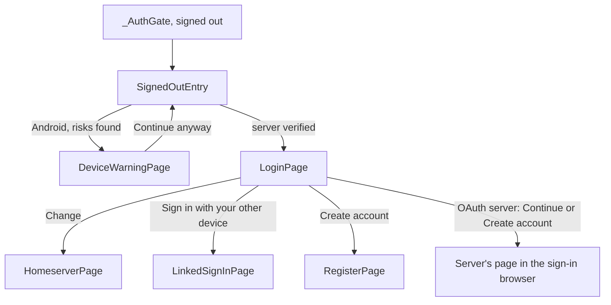
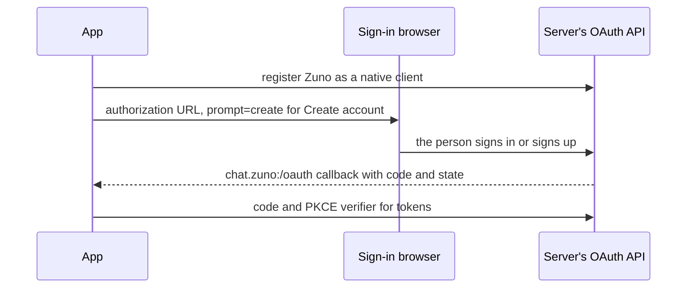
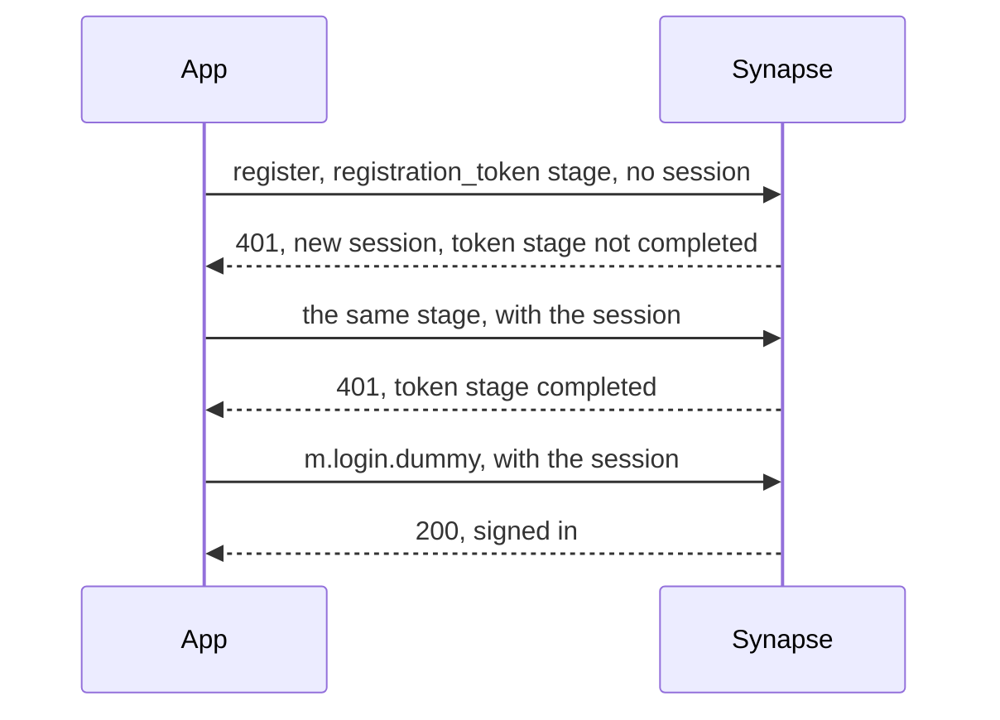

# Authentication

The signed-out side of the app and the account lifecycle: choosing a server,
signing in with a password or with a code from another device, signing in
and up through the server's own pages on servers that use Matrix's OAuth 2.0
API (MAS), signing up with a code from the server's admin where it requires
one, keeping the session alive with refresh tokens, the server's account
page, signing out and deleting the account. The device safety check and the
password rules live here too.

There is no repository or local session model. Screens call the Matrix SDK
directly, and the `Client` and its login state are the source of truth.
Protocol logic lives in pure functions in `lib/core/matrix/auth/` and
`lib/core/matrix/account/`, not in widgets. Routing (`_AuthGate`) and the
sign-out wipe are in `app-foundation.md`; the device list and verification
are in `security-verification.md`.

## Architecture

| Piece | Role |
|---|---|
| `SignedOutEntry` | What `_AuthGate` shows when signed out: the device warning first on Android, then `LoginPage` once the server is verified, or a retry screen. |
| `homeserverProvider` | Holds the adopted `ServerChoice`: the picked server and its API address. `zuno.chat` by default in every build; `adopt(choice)` takes a checked server and points the client at its API address. |
| `signUpPathProvider` | The sign-up path of one server choice: open, code, the server's page, closed or can't tell. |
| `LoginPage` | The root signed-out screen: username and password, sign-in with another device, "Create account" unless sign-up is closed, and "Change" for the server. On an OAuth server, one "Continue" and "Create account", both opening the server's page. |
| `LinkedSignInPage` | Signs in with a code from another device, scanned or typed. |
| `RegisterPage` | Username, password and confirmation, plus the sign-up code when one is required. |
| `server_choice.dart` | `checkServer`, and how a probe answer becomes a sign-up path. |
| `registration_support.dart` | The registration probe, input checks and the UIA stage machine (`nextRegistrationStep`, driven by `runRegistration`). |
| `linked_sign_in.dart` | Encodes, decodes, mints and redeems sign-in codes. |
| `oauth_sign_in.dart`, `auth_browser.dart` | The browser sign-in: Zuno's client registration, the authorization in the system's sign-in browser (ASWebAuthenticationSession, Custom Tabs) and the callback check. |
| `account_capabilities.dart`, `account_page_browser.dart` | What the server lets Zuno do itself and where its account page is, and opening that page in the sign-in browser. |
| `typed_server_answers.dart` | Turns a server answer that is no Matrix error into a typed failure carrying only its status, OAuth error and `Retry-After`. |
| `session_refresh.dart` | `refreshSession`, the client's `onSoftLogout` handler. |
| `homeserver_input.dart`, `server_name.dart` | Parse the server field, and derive the account's server name, which is not the API host. |
| `auth_error_message.dart` | Maps every auth refusal to user-facing copy. |
| `device_safety.dart` + `DeviceSafety.kt` | The Android root and bootloader check behind the device warning. |

In Settings, `SignInAnotherDevicePage` mints sign-in codes,
`ChangePasswordDialog` changes the password and `DeleteAccountTile` deletes
the account; the first two show only where the server allows them
(`account_capabilities.dart`). On an OAuth server, password change, signing
out other devices and deletion happen on the server's account page instead.
The password rules (`password_strength.dart`) are shared by registration,
change password and the security phrase.

## Flows

### Server check

Launch while signed out checks and adopts `zuno.chat`; the server screen
checks a typed server and adopts it if the screen is still open. Back works
mid-check, and nothing is saved to disk.

1. **Discovery.** `checkServer` reads the server's
   `/.well-known/matrix/client` through the SDK's `MatrixApi` aimed at that
   server. Any failure, or an unusable `base_url`, makes the typed server
   the API address, as the SDK's own discovery does.
2. **Check.** That address is asked for its versions, its OAuth sign-in
   details and its sign-in methods together. A server with OAuth sign-in
   details signs in through its own page; otherwise one that lists sign-in
   methods without password sign-in is refused.
3. **Adopt.** `homeserverProvider.adopt` holds the picked server and the
   checked API address as the `ServerChoice`, and points the client at the
   API address.

### Sign-in and session refresh

Every sign-in (password, code from another device, registration, the
browser) runs inside `SignInInFlight.during`, which keeps the signed-out
screens up until the SDK call returns. Every sign-in also asks for a refresh
token, because the homeserver issues short-lived access tokens, and
`refreshSession` renews the session on soft logout. A password session
refreshes at `/refresh`; a browser session at the token endpoint in the
server's OAuth details, which the SDK picks by the client ID it stored at
sign-in.

### Browser sign-in (OAuth servers)

1. **Register.** Every flow registers Zuno afresh, as the spec asks: its
   name, homepage, logo, terms and privacy links, and the redirect
   `chat.zuno:/oauth`.
2. **Authorize.** The authorization page opens in the system's sign-in
   browser with the stable scopes and a new device ID; "Create account"
   adds `prompt=create`.
3. **Callback.** Its `state` is checked before anything else is read. A
   closed browser or `access_denied` is a cancel and shows nothing.
4. **Tokens.** The SDK exchanges the code with its PKCE verifier, and Zuno
   names the device.
5. **Sign-up.** A "Create account" flow marks the account as registered for
   onboarding and reads once whether the person set a name there
   (`onboarding.md`).

### Account page (OAuth servers)

Actions the server keeps for itself open its account page in the sign-in
browser, and Zuno waits until the page is closed.

| Entry | Account-page action |
|---|---|
| Account → Manage account | `org.matrix.profile` |
| Your devices: sign out one device, or everywhere else | `org.matrix.device_delete` with the device ID, `org.matrix.devices_list` |
| Delete account, after a warning | `org.matrix.account_deactivate` |
| A step the server approves instead of a password (UIA `m.oauth`, `org.matrix.cross_signing_reset`) | The link the server sends, then "Continue" retries the request |

Closing the page refreshes the session at once, so a deletion or this
device's removal there wipes the app then, not at the next sync. Your devices reloads once the page is closed. An action the server
doesn't advertise opens the plain account page.

### Registration

1. **Probe.** Once per server choice, a raw POST of an empty body to the
   choice's `/_matrix/client/v3/register`, read for its refusal. A `401`
   offering a flow made only of `m.login.dummy` and
   `m.login.registration_token` is `available`, other flows are
   `unsupportedFlow`, a `403` is `disabled`, and anything else is
   `unknown`.
2. **Path.** The probe decides where "Create account" leads:

   | Probe | Path | "Create account" |
   |---|---|---|
   | `available`, a flow needs no code | open | `RegisterPage` |
   | `available`, every flow needs a code | code | `RegisterPage` with the code field |
   | `disabled` or `unsupportedFlow` | closed | hidden |
   | `unknown` | can't tell | shown; the tap asks once more, then routes or explains |

3. **Register.** `runRegistration` sends one UIA stage per
   `client.register` call, the token stage first when a code is required.
   Without a code it is a single `m.login.dummy` call. The UI always says
   "code"; the wire and the Dart code say registration token.

Against Synapse, a registration with a code takes three round trips:

### Sign-in on another device

| Side | What happens |
|---|---|
| Signed-in device | `SignInAnotherDevicePage` asks for the password, mints a login token (MSC3882) and shows it as a QR code holding `ZUNO-SIGN-IN 1 <server name> <token>`, and as text to type, the server name above the grouped token, until it expires. |
| New device | `LinkedSignInPage` scans the QR code or takes typed text, and signs in with `m.login.token`. |

- **Typed text must be the two lines or the QR code's text pasted**, so
  every code names its server; anything else asks for both lines, and
  nothing reaches a server.
- **One redeem function checks the server** for scanned and typed codes
  alike, comparing hosts only, because a server name's port is its
  federation port, not the client API's.

### Sign-out and account deletion

| Path | Steps, in order |
|---|---|
| Sign out (Account, or this device in Your devices) | Refused while offline. End the active call and clear live location shares (each bounded), `stopAllNotificationDelivery`, then `client.logout()` |
| Delete account | Warning, typed username, password, ending the active call and clearing live location shares, `deactivateAccount(erase: true)`, best-effort push teardown, then `client.clear()` |

Both paths end in `client.clear`, which triggers the `_AuthGate` wipe;
neither cleans local data itself, and every new path must end there too.
A session ended elsewhere, such as on the account page, ends there as well:
the next request is refused, the refresh is refused, and the refresh
handler clears.
What the push teardown does is in `notifications.md`.

## Decisions

### Server and sign-in

- **Any build can use another server; `zuno.chat` is the default**, a
  "Change" away from the sign-in screen, in release builds too.
- **A server name is not the homeserver host.** Discovery leads to the API
  host, so user IDs and aliases take the domain of `client.userID`, and
  only module URLs and push use `client.homeserver`.
- **The server check never touches the app's one client**, and only
  `adopt` points it, so a check that fails or is left can't send a sign-in
  or a probe to a server the screen no longer names.
- **A sign-in code never switches the server.** The code names the server
  that minted it and a mismatch is refused, because switching automatically
  would let a hostile code sign someone into an attacker's server.
- **A server whose discovery points at http is refused with a message
  that says so**, not as unreachable, because Dart connects only over
  https (`app-foundation.md`).
- **Sign-in codes are plain text, scanned in-app only.** A URL would open
  from the system camera and leave the token in scan and browser history.
- **A sign-in leaves the signed-out screens only once its SDK call
  returns.** The SDK reports `loggedIn` before its first sync, so the gate
  would otherwise show an empty chat list and onboarding would decide on
  pre-sync facts.
- **One message for a wrong username or a wrong password**, keeping
  Matrix's ambiguity against account enumeration.
- **Settings shows Change password unless the server's `m.change_password`
  capability is off, and Sign in on another device only when
  `m.get_login_token` is on.** Both wait for the answer, so an OAuth server's
  entries never flash, and show when it can't be read, so a failed read
  never hides a working entry.

### OAuth servers

- **The sign-in method is decided once, at the server check**: OAuth when
  the server serves its OAuth details, because a session works only with the
  API that issued its token.
- **No password form on an OAuth server**, though MAS's compatibility layer
  accepts one, because the spec keeps the two APIs apart and the server's
  page owns two-factor sign-in and upstream sign-in providers.
- **The sign-in browser forgets its session when it closes** (ephemeral),
  because MAS offers no way to end a browser session and ignores
  `prompt=login`, so a kept session would outlive sign-out; the account page
  asks for the password on each visit, and on Android only browsers with
  private tabs honor it.
- **Account pages open in the sign-in browser, not the default browser**, so
  Zuno knows when the page closes and the visit leaves no session behind.
- **A session check after the page closes skips a signed-out client**, since
  the SDK's sign-out keeps the token expiry and a soft logout would flash the
  signed-in screens before failing.
- **The client registration describes the app, the same on every server**,
  and the redirect scheme is the homepage's host reversed, as the spec
  requires; the Android manifest registers that scheme too, so the
  homepage, the redirect and the manifest change together.
- **A "Create account" flow counts as a sign-up for onboarding** even if the
  person signs in on the server's page instead, since the server doesn't
  say which happened.
- **The browser button says only "Continue"**, because a server name in it
  wraps; the name shows in the row below.

### Sessions

- **Only `M_UNKNOWN_TOKEN` and `M_FORBIDDEN` from `/refresh`, or
  `invalid_grant` from the token endpoint, end a session, and the refresh
  handler ends it itself.** Every other failure stays a plain exception
  carrying only its code, so a transient server fault never wipes the
  device's keys.
- **The handler never hands the SDK a Matrix or OAuth error.** The SDK keeps
  a refresh that failed that way and replays it to every later request, and
  iOS keeps the same client across sign-out and sign-in, so the next sign-in
  would stop syncing and sending within one token lifetime
  (famedly/matrix-dart-sdk#2445).
- **The SDK keeps the old token's expiry after `clear()`**, so the handler
  also runs for a signed-out client and must end it, never refresh it.
- **A refused refresh is retried once if the stored token changed.** The
  app and a push engine's client share one refresh token that the server
  rotates on every use, so the loser of that race re-reads the winner's
  token and retries.
- **A refresh that hangs is aborted at the network, not just given up
  on**, because the server drops the pair it issued when the same refresh
  token is used again, and a late answer saved over the next refresh would
  sign the device out. That covers the OAuth refresh and the fetch of the
  OAuth details it needs.

### Registration and sign-up codes

- **The probe is a raw HTTP POST, not `Client.register`**, which throws on
  `401` and signs the caller in on success.
- **One probe per server choice decides the sign-up path**, kept only while
  the signed-out screens show, so "Create account" opens the right screen
  without another round trip and a later visit asks afresh.
- **A failed probe never fails the server check or hides "Create
  account"**, because sign-in needs no sign-up, and a flaky network must
  not look like closed sign-up.
- **Each real attempt opens its own UIA session.** Synapse binds a session
  to the body that opened it, so the probe's session is never reused, and a
  "changed during the UI authentication session" refusal restarts once.
- **A stage refused before any session existed is resent with the new
  session.** Synapse examines a registration token only once a session
  exists, so only the resend can blame the code.
- **A refused code is detected from `completed`, not the errcode.** A bad
  code and "one more stage needed" are both a `401` with `flows` and a
  `session`; the sent stage missing from `completed` is the only reliable
  sign.
- **An interrupted sign-up resumes its session** while the username,
  password and code are unchanged, because the code is already spent in it.
  This is built from Synapse's documented behavior, not verified live.
- **The code field takes a Synapse registration token as typed**, filtered
  only to Synapse's format (`A-Za-z0-9._~-`, at most 64 characters), and its
  hint names the server's admin, who issues those tokens.
- **A refused code offers no "send a new code"**, since only the server's
  admin can issue another.
- **Creating an account accepts the terms, and `RegisterPage` says so**, as
  Google Play requires; the line appears only on `zuno.chat`.

### Passwords and usernames

- **Account passwords follow the Matrix spec's client rule, then the guess
  checks**: at least 8 characters with a lowercase letter, an uppercase
  letter, a number and a symbol, in any script, so `Password1!` still fails
  as common. The security phrase keeps 12 characters and no kinds, since
  only Zuno checks it.
- **A server's own stricter policy is answered, not guessed.** Its refusal
  (`M_WEAK_PASSWORD` or an `M_PASSWORD_*` code) says the server needs a
  stronger password, at sign-up and in change password alike.
- **The gate scores what is left once the guessable parts are gone.**
  Common words, years, keyboard walks and runs are masked out before
  scoring, so a padded known-bad password (`summer2026!!`) is refused while
  three everyday words pass as weak.
- **"Confirm password" stays**, because sign-up ties no email to the
  account, so with no password reset a typo at sign-up loses it.
- **New usernames use exactly Matrix's set**, `a-z 0-9 . _ = - / +`, with
  the user ID under 255 bytes and no server-specific rules, so the same
  name works on any server; it filters every field where a username is
  typed.
- **`LoginPage` lowercases the username but never filters it**, so a full
  `@user:server` and older names still sign in.

### Autofill

- **Every text field states its autofill choice**, because Flutter leaves
  autofill on unless `autofillHints` is `null`, which would hand message
  drafts to a password manager. `ZunoTextField` requires the choice, and
  `text_field_owners_test.dart` fails on a field built any other way than it
  or `SecretTextField`.
- **Only an accepted credential is offered for saving.** Re-auth prompts
  cancel their autofill context, and change password finishes it only on
  success.
- **The security phrase fields opt out of autofill**, because a manager
  would offer the account password there, and the homeserver sees that
  password at login.
- **Sign-in and registration lift Android 14+'s accessibility-data-sensitive
  mark while they show** (`settings.md`), so a password manager working as
  an accessibility service can fill them; managers on the autofill
  framework work on every screen regardless.

### Account deletion

- **Deactivation always erases, with no toggle.** Erasure only hides
  messages from people who join later, and a toggle would present that as a
  stronger promise than it is.
- **The typed username is friction on purpose**, because nothing undoes a
  deletion.
- **Sign-out stops push before `logout()`, deletion after deactivating.**
  Sign-out must tear down while the token still works, while deletion can
  still fail at its password prompt, and tearing down first would silence a
  live account. The active call is ended and live location shares are
  cleared first for the same reason: only a working token can write their
  end. Both are read when the wind-down runs, so a call answered meanwhile
  ends too.
- **Sign-out is refused offline, and a server failure inside `logout()`
  still counts as signed out**, because the SDK clears the device whatever
  the server answers: offline that would strand a live server session, and
  after a failure "not signed out" would be false.
- **Deletion ends the call and the shares at the password Confirm, whatever
  the server answers**, because the server checks the password and deletes
  in one request with no dry run. The prompt says so whenever something is
  live.

### Device safety (Android only)

- **The warning informs; it never blocks.** It shows until "Continue
  anyway" is tapped once, and a failed or slow check shows nothing, since a
  false alarm costs more than a miss.
- **Unlocked means an attested unlocked boot or boot properties saying so.**
  The two sources are OR-ed, a relocked custom system counts as safe, and
  Play Integrity is out because it needs Google and a server.
- **The check is lazy.** Only `SignedOutEntry` runs it, so a signed-in cold
  start never mints an attestation key.

## Gotchas

- Parse server input only with `parseHomeserverInput`, because a naive
  `Uri` misreads `@user:example.org` and fails late on spaces.
- The server screen adopts a check only while its route is still active,
  not merely mounted, because a popped route stays mounted through its exit
  animation and a check finishing then would adopt the server just left.
- After a sign-out the server resets to the default, because `clear()`
  nulls `client.homeserver` and `_AuthGate` invalidates
  `homeserverProvider`; `SignedOutEntry` shows its spinner during that
  check, or the previous server's sign-in screen would stay up.
- The capability answer behind the Settings entries, the account page
  included, is saved in the client database for 3 days, the SDK's lifetime for saved server answers, so a
  server's change reaches phones within that time, or at once after
  Settings' Clear cache, which drops it with the SDK's other saved answers.
- Route every refusal through `auth_error_message.dart`, because these
  screens show any text they are given, raw exceptions included.
- A mandatory captcha, terms or email stage hides "Create account", so a
  server that needs email confirmation, a captcha or terms runs MAS.
- Synapse's optional password policy counts only ASCII letters, so a
  password whose only uppercase letter is, say, Greek passes Zuno and is
  refused by such a server.
- Tests of the browser sign-in install a SHA-256-only vodozemac mock
  (`sha256_only_vodozemac.dart`), because the SDK's PKCE needs vodozemac's
  SHA-256 and vodozemac has no public test mode.
- On Android, `enableSuggestions: false` swaps out the `@` and `/` keys, so
  email and URL fields set only `autocorrect: false`.
- Nothing on the submit side can force a password-manager save on Android;
  that needs Credential Manager.
- A rate limit holds the submit in its handler, not only on the button,
  because the keyboard's Done calls the handler directly.
- `DeleteAccountTile` touches the client only in its tap handler, because
  `SettingsPage` tests render without one.
- Tests rendering a signed-out screen override `homeserverProvider` with
  `FixedHomeserver`, `signUpPathProvider` and `deviceRisksProvider`, and
  tests rendering Account or Your devices override
  `accountCapabilitiesProvider`, or they hit the network or stall on the
  splash.

## Not built

- Data export ("download my data"), which would sit beside Delete account.
- An explicit password-manager save (Credential Manager).
- Signing in a new device from a signed-in one on OAuth servers, where
  sign-in codes are off; OAuth's device sign-in (RFC 8628) would replace
  them.
