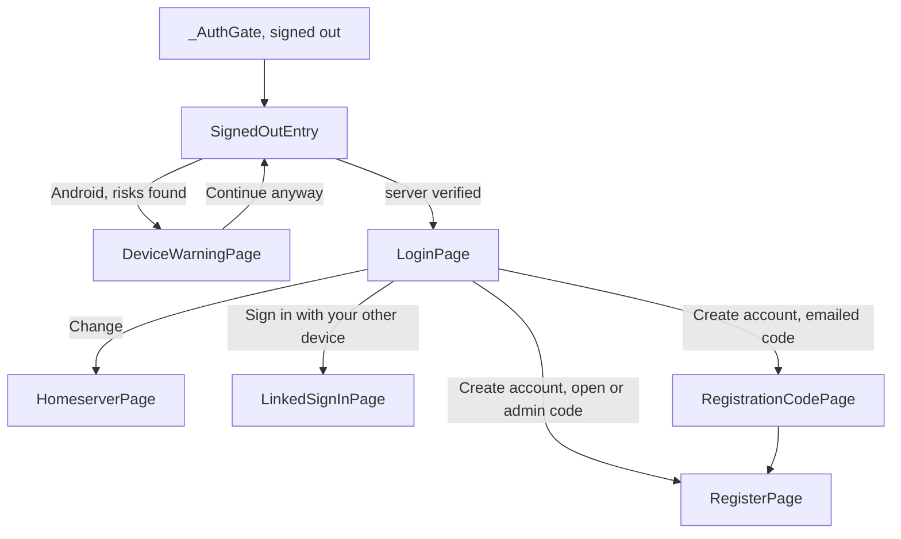
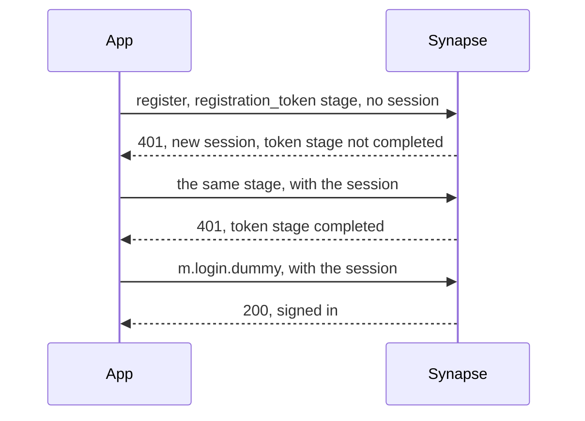

# Authentication

The signed-out side of the app and the account lifecycle: choosing a server,
signing in with a password or with a code from another device, signing up
with an emailed code, keeping the session alive with refresh tokens, signing
out and deleting the account. The device safety check and the password rules
live here too.

There is no repository or local session model. Screens call the Matrix SDK
directly, and the `Client` and its login state are the source of truth.
Protocol logic lives in pure functions in `lib/core/matrix/`, not in
widgets. Routing (`_AuthGate`) and the sign-out wipe are in
`app-foundation.md`; the device list and verification are in
`security-verification.md`.

## Architecture

| Piece | Role |
|---|---|
| `SignedOutEntry` | What `_AuthGate` shows when signed out: the device warning first on Android, then `LoginPage` once the server is verified, or a retry screen. |
| `homeserverProvider` | Holds the checked `ServerChoice`: the picked server, its API address and whether it announces emailed sign-up codes. `zuno.chat` by default in every build; `use(uri)` checks a typed server and adopts it on success. |
| `signUpPathProvider` | The sign-up path of one server choice: open, emailed code, admin code, closed or can't tell. |
| `LoginPage` | The root signed-out screen: username and password, sign-in with another device, "Create account" unless sign-up is closed, and "Change" for the server. |
| `LinkedSignInPage` | Signs in with a code from another device, scanned or typed. |
| `RegistrationCodePage` | Has the server email a sign-up code. Shown only on the emailed-code path. |
| `RegisterPage` | Username, password and confirmation, plus the emailed or admin code when one is required. |
| `server_choice.dart` | The discovery read and how a probe answer becomes a sign-up path. |
| `registration_support.dart` | The registration probe, input checks and the UIA stage machine (`nextRegistrationStep`, driven by `runRegistration`). |
| `linked_sign_in.dart` | Encodes, decodes, mints and redeems sign-in codes. |
| `session_refresh.dart` | `refreshSession`, the client's `onSoftLogout` handler. |
| `homeserver_input.dart`, `server_name.dart` | Parse the server field, and derive the account's server name, which is not the API host. |
| `auth_error_message.dart` | Maps every auth refusal to user-facing copy. |
| `device_safety.dart` + `DeviceSafety.kt` | The Android root and bootloader check behind the device warning. |

In Settings, `SignInAnotherDevicePage` mints sign-in codes,
`ChangePasswordDialog` changes the password and `DeleteAccountTile` deletes
the account; the first two show only where the server allows them
(`account_capabilities.dart`). The password rules (`password_strength.dart`)
are shared by registration, change password and the security phrase.

## Flows

### Server check

Launch while signed out checks `zuno.chat`, and picking a server checks
that one; nothing is saved to disk.

1. **Discovery.** Zuno reads the server's `/.well-known/matrix/client`
   itself. A missing file means the server is its own API host and
   announces nothing; an unreachable one also falls back to the typed
   server but leaves the announcement unknown.
2. **Check.** `checkHomeserver` on that API address, with the SDK's own
   discovery step and its auth-metadata fetch off.
3. **Choice.** The picked server, the checked API address and the
   announcement become the `ServerChoice`.

### Sign-in and session refresh

Every sign-in (password, code from another device, registration) runs
inside `SignInInFlight.during`, which keeps the signed-out screens up until
the SDK call returns. Every sign-in also asks for a refresh token, because
the homeserver issues short-lived access tokens, and `refreshSession`
renews the session on soft logout.

### Registration

1. **Probe.** Once per server choice, a raw POST of an empty body to the
   choice's `/_matrix/client/v3/register`, read for its refusal. A `401`
   offering a flow made only of `m.login.dummy` and
   `m.login.registration_token` is `available`, other flows are
   `unsupportedFlow`, a `403` is `disabled`, and anything else is
   `unknown`.
2. **Path.** The probe and the server's announcement decide where "Create
   account" leads:

   | Probe | Path | "Create account" |
   |---|---|---|
   | `available`, a flow needs no code | open | `RegisterPage` |
   | `available`, every flow needs a code, announced | emailed code | `RegistrationCodePage`, then `RegisterPage` |
   | `available`, every flow needs a code, nothing announced | admin code | `RegisterPage` with the code field |
   | `disabled` or `unsupportedFlow` | closed | hidden |
   | `unknown`, or the announcement unreadable | can't tell | shown; the tap asks once more, then routes or explains |

   **Server contract**: a server running `zuno_register` announces it with
   a `chat.zuno.register` object in its `/.well-known/matrix/client`. An
   announcement unreadable at the server check is read once more when a
   code turns out to be needed.
3. **Code.** On the emailed path, `POST
   /_synapse/client/zuno/register/token` with `{email}` asks the
   `zuno_register` Synapse module to mail a single-use registration token.
   `202` means go on; a `404` or `503` means sign-up is closed, since a
   module without mail settings registers no route. The UI always says
   "code"; the wire and the Dart code say registration token.
4. **Register.** `runRegistration` sends one UIA stage per
   `client.register` call, the token stage first when a code is required,
   emailed or admin. Without a code it is a single `m.login.dummy` call.

Against Synapse, a registration with a code takes three round trips:

### Sign-in on another device

| Side | What happens |
|---|---|
| Signed-in device | `SignInAnotherDevicePage` asks for the password, mints a login token (MSC3882) and shows it as a QR code holding `ZUNO-SIGN-IN 1 <server name> <token>`, and as text to type, the server name above the grouped token, until it expires. |
| New device | `LinkedSignInPage` scans the QR code or takes typed text, and signs in with `m.login.token`. |

- **Typed text may be the two lines, the QR code's text pasted, or the
  token alone**, since devices on older versions show no server name. A
  server line alone asks for the code.
- **One redeem function checks the server** for scanned and typed codes
  alike, comparing hosts only, because a server name's port is its
  federation port, not the client API's.

### Sign-out and account deletion

| Path | Steps, in order |
|---|---|
| Sign out (Settings, or this device in Your devices) | Refused while offline. End the active call and clear live location shares (each bounded), `stopAllNotificationDelivery`, then `client.logout()` |
| Delete account | Warning, typed username, password, ending the active call and clearing live location shares, `deactivateAccount(erase: true)`, best-effort push teardown, then `client.clear()` |

Both paths end in `client.clear`, which triggers the `_AuthGate` wipe;
neither cleans local data itself, and every new path must end there too.
What the push teardown does is in `notifications.md`.

## Decisions

### Server and sign-in

- **Any build can use another server; `zuno.chat` is the default**, a
  "Change" away from the sign-in screen, in release builds too.
- **A server name is not the homeserver host.** Discovery leads to the API
  host, so user IDs and aliases take the domain of `client.userID`, and
  only module URLs and push use `client.homeserver`.
- **Zuno reads the discovery file itself, and only once per check**,
  because the SDK's discovery step treats a missing file and an unreachable
  one alike, and the same file carries the sign-up announcement.
- **A sign-in code never switches the server.** The code names the server
  that minted it and a mismatch is refused, because switching automatically
  would let a hostile code sign someone into an attacker's server.
- **A server whose discovery points at http is refused with a message
  that says so**, not as unreachable, because Dart connects only over
  https (`app-foundation.md`).
- **Sign-in codes are plain text, scanned in-app only.** A URL would open
  from the system camera and leave the token in scan and browser history.
- **A sign-in leaves the signed-out screens only once its SDK call
  returns.** The SDK reports `loggedIn` before its first sync, so the gate
  would otherwise show an empty chat list and onboarding would decide on
  pre-sync facts.
- **One message for a wrong username or a wrong password**, keeping
  Matrix's ambiguity against account enumeration.
- **Settings shows Change password unless the server's `m.change_password`
  capability is off, and Sign in on another device only when
  `m.get_login_token` is on.** Both show while the answer loads or when it
  can't be read, so a slow or failed read never hides a working entry.

### Sessions

- **Only `M_UNKNOWN_TOKEN` and `M_FORBIDDEN` from `/refresh` end a
  session.** The SDK clears the local session on any `MatrixException` from
  the handler, so other errors become plain exceptions, or a transient
  server fault would wipe the device's keys.
- **A refused refresh is retried once if the stored token changed.** The
  app and a push engine's client share one refresh token that the server
  rotates on every use, so the loser of that race re-reads the winner's
  token and retries.
- **A refresh that hangs is aborted at the network, not just given up
  on**, because the server drops the pair it issued when the same refresh
  token is used again, and a late answer saved over the next refresh would
  sign the device out.

### Registration and sign-up codes

- **The probe is a raw HTTP POST, not `Client.register`**, which throws on
  `401` and signs the caller in on success.
- **One probe per server choice decides the sign-up path**, kept only while
  the signed-out screens show, so "Create account" opens the right screen
  without another round trip and a later visit asks afresh.
- **A failed probe never fails the server check or hides "Create
  account"**, because sign-in needs no sign-up, and a flaky network must
  not look like closed sign-up.
- **The emailed path needs the announcement, not just a required code**,
  because a plain Synapse server hands out registration tokens through its
  admin and has no route to email one.
- **Each real attempt opens its own UIA session.** Synapse binds a session
  to the body that opened it, so the probe's session is never reused, and a
  "changed during the UI authentication session" refusal restarts once.
- **A stage refused before any session existed is resent with the new
  session.** Synapse examines a registration token only once a session
  exists, so only the resend can blame the code.
- **A refused code is detected from `completed`, not the errcode.** A bad
  code and "one more stage needed" are both a `401` with `flows` and a
  `session`; the sent stage missing from `completed` is the only reliable
  sign.
- **An interrupted sign-up resumes its session** while the username,
  password and code are unchanged, because the code is already spent in it.
  This is built from Synapse's documented behavior, not verified live.
- **Each code field mirrors its issuer.** The emailed-code field uppercases
  and filters input to `zuno_register`'s alphabet (`A-HJ-NP-Z2-9`) and the
  copy states its 24-hour lifetime, so the field and the module must change
  together; the admin-code field takes a Synapse registration token as
  typed, within Synapse's format (`A-Za-z0-9._~-`, at most 64 characters).
- **A refused admin code offers no "send a new code"**, since only the
  server's admin can issue another.
- **A `202` promises no delivery**, because the module also answers `202`
  when its rate limit suppressed the send.
- **An email address buys a code and nothing else.** No account is tied to
  it, and there is no email password reset.
- **Creating an account accepts the terms, and `RegisterPage` says so**, as
  Google Play requires; the line appears only on `zuno.chat`.

### Passwords and usernames

- **Password rules follow NIST SP 800-63B, not composition rules.** The
  floor is 12 characters to match Synapse's `minimum_length`, and there are
  no character-class requirements, since they produce `Password1!` and
  block strong passphrases.
- **The gate scores what is left once the guessable parts are gone.**
  Common words, years, keyboard walks and runs are masked out before
  scoring, so a padded known-bad password (`summer2026!!`) is refused while
  three everyday words pass as weak.
- **"Confirm password" stays**, because with no email reset a typo at
  sign-up loses the account.
- **New usernames use a stricter set than Matrix.** `signupUsernameChars`
  (`a-z0-9._`, at least one letter, no leading underscore) filters every
  field where a username is typed, since names get spoken, typed on phones
  and put in URLs. Mentions match the wider `matrixLocalpartChars`, so
  federated names still resolve.
- **`LoginPage` lowercases the username but never filters it**, so a full
  `@user:server` and older names still sign in.

### Autofill

- **Every text field states its autofill choice**, because Flutter leaves
  autofill on unless `autofillHints` is `null`, which would hand message
  drafts to a password manager. `ZunoTextField` requires the choice, and
  `text_field_owners_test.dart` fails on a field built any other way than it
  or `SecretTextField`.
- **Only an accepted credential is offered for saving.** Re-auth prompts
  cancel their autofill context, and change password finishes it only on
  success.
- **The security phrase fields opt out of autofill**, because a manager
  would offer the account password there, and the homeserver sees that
  password at login.
- **Sign-in and registration lift Android 14+'s accessibility-data-sensitive
  mark while they show** (`settings.md`), so a password manager working as
  an accessibility service can fill them; managers on the autofill
  framework work on every screen regardless.

### Account deletion

- **Deactivation always erases, with no toggle.** Erasure only hides
  messages from people who join later, and a toggle would present that as a
  stronger promise than it is.
- **The typed username is friction on purpose**, because nothing undoes a
  deletion.
- **Sign-out stops push before `logout()`, deletion after deactivating.**
  Sign-out must tear down while the token still works, while deletion can
  still fail at its password prompt, and tearing down first would silence a
  live account. The active call is ended and live location shares are
  cleared first for the same reason: only a working token can write their
  end. Both are read when the wind-down runs, so a call answered meanwhile
  ends too.
- **Sign-out is refused offline, and a server failure inside `logout()`
  still counts as signed out**, because the SDK clears the device whatever
  the server answers: offline that would strand a live server session, and
  after a failure "not signed out" would be false.
- **Deletion ends the call and the shares at the password Confirm, whatever
  the server answers**, because the server checks the password and deletes
  in one request with no dry run. The prompt says so whenever something is
  live.

### Device safety (Android only)

- **The warning informs; it never blocks.** It shows until "Continue
  anyway" is tapped once, and a failed or slow check shows nothing, since a
  false alarm costs more than a miss.
- **Unlocked means an attested unlocked boot or boot properties saying so.**
  The two sources are OR-ed, a relocked custom system counts as safe, and
  Play Integrity is out because it needs Google and a server.
- **The check is lazy.** Only `SignedOutEntry` runs it, so a signed-in cold
  start never mints an attestation key.

## Gotchas

- Parse server input only with `parseHomeserverInput`, because a naive
  `Uri` misreads `@user:example.org` and fails late on spaces.
- A failed `checkHomeserver` nulls `client.homeserver`, so `use()` restores
  the previous server before rethrowing.
- `checkHomeserver` points the app's one client at the candidate server
  before it passes, so the server screen refuses Back while checking and
  the sign-up probe targets its choice's API address, never the client's;
  otherwise a sign-in or probe would reach a server the screen no longer
  names.
- After a sign-out the server resets to the default, because `clear()`
  nulls `client.homeserver` and `_AuthGate` invalidates
  `homeserverProvider`; `SignedOutEntry` shows its spinner during that
  check, or the previous server's sign-in screen would stay up.
- The capability answer behind the Settings entries is saved in the client
  database for 3 days, the SDK's lifetime for saved server answers, so a
  server's change reaches phones within that time, or at once after
  Settings' Clear cache, which drops it with the SDK's other saved answers.
- Route every refusal through `auth_error_message.dart`, because these
  screens show any text they are given, raw exceptions included.
- A mandatory captcha or terms stage hides "Create account", so ship the
  client stage before turning a requirement on server-side.
- On Android, `enableSuggestions: false` swaps out the `@` and `/` keys, so
  email and URL fields set only `autocorrect: false`.
- Nothing on the submit side can force a password-manager save on Android;
  that needs Credential Manager.
- A rate limit holds the submit in its handler, not only on the button,
  because the keyboard's Done calls the handler directly.
- `DeleteAccountTile` touches the client only in its tap handler, because
  `SettingsPage` tests render without one.
- Tests rendering a signed-out screen override `homeserverProvider` with
  `FixedHomeserver`, `signUpPathProvider` and `deviceRisksProvider`, and
  tests rendering Account or Your devices override
  `accountCapabilitiesProvider`, or they hit the network or stall on the
  splash.

## Not built

- Data export ("download my data"), which would sit beside Delete account.
- An explicit password-manager save (Credential Manager).
- Sign-up code extras: resend countdown, a link from the email into the
  app, an invite allowlist and delivery feedback.
