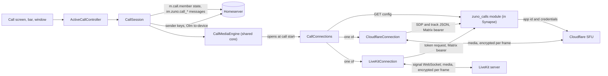
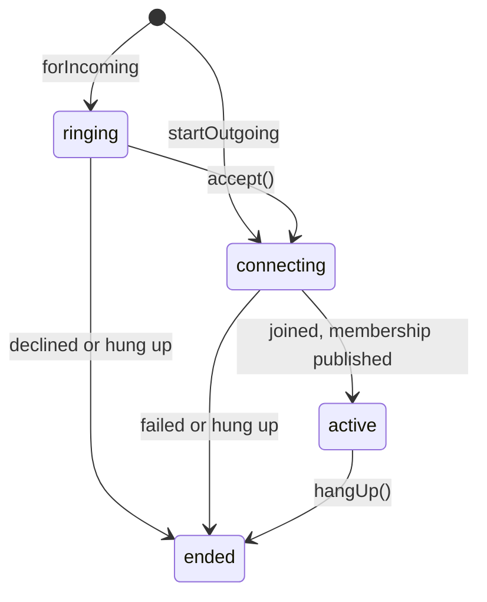
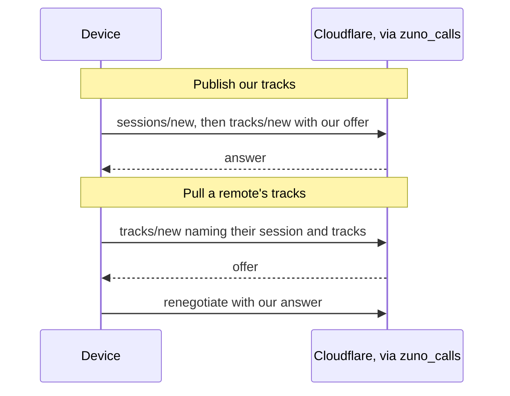
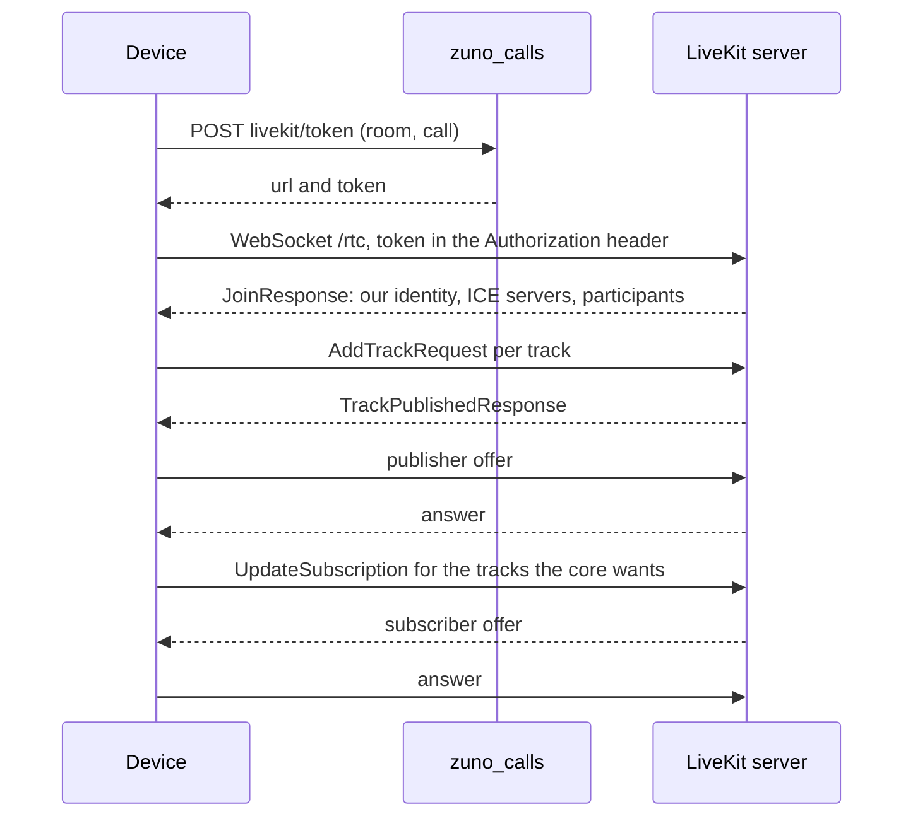
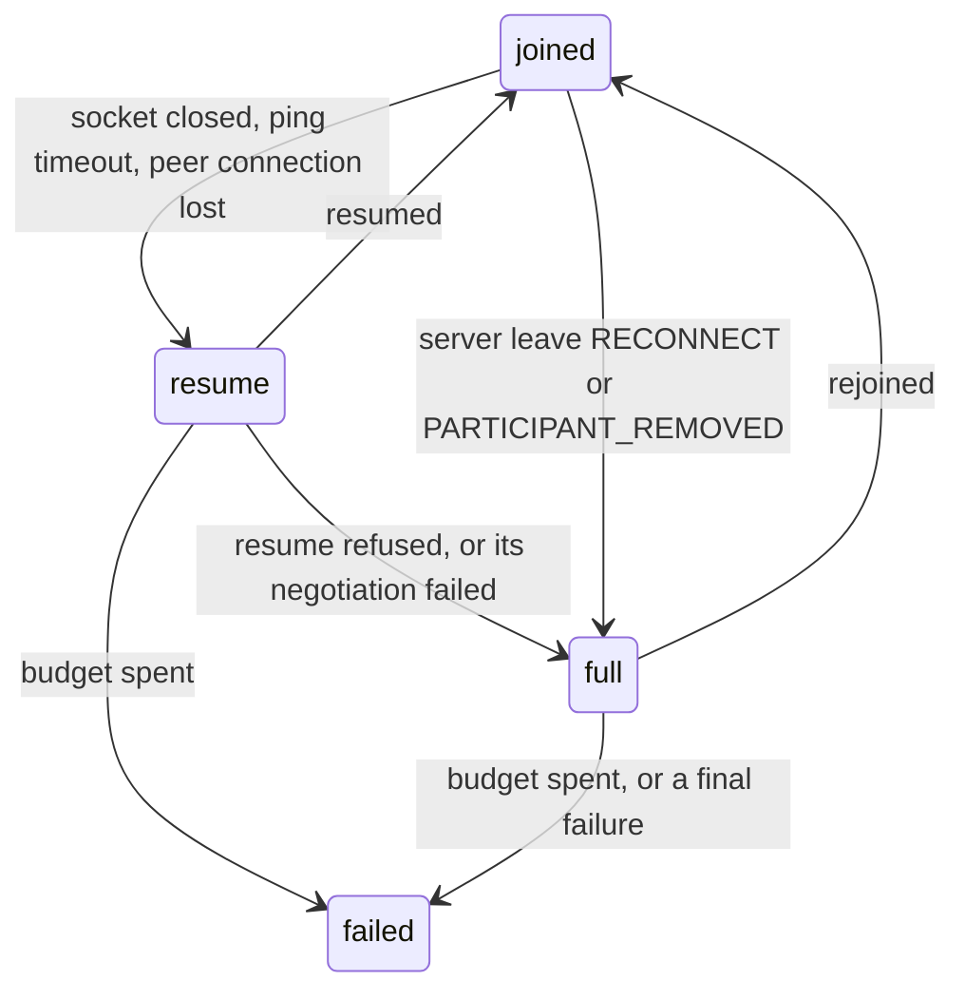
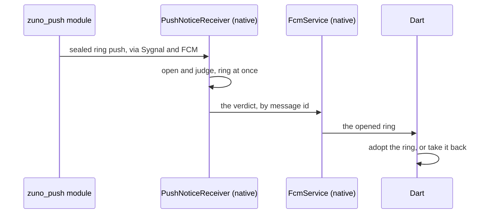
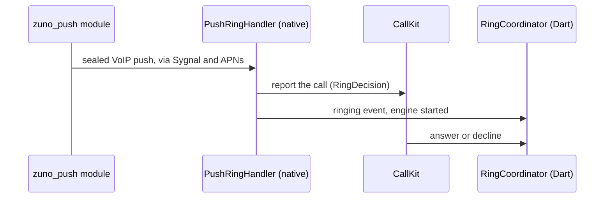

# Calls

Voice and video calls, one-to-one and group, always routed through an SFU:
Cloudflare's or a LiveKit server, whichever the homeserver's `zuno_calls`
Synapse module names. The module also caps how many people a call holds.
There is no peer-to-peer mode, by design. Signaling is a custom layer
loosely modeled on MatrixRTC (MSC3401), not a conformant implementation.
Media is encrypted per frame, each device under its own random key that
changes whenever someone leaves, is removed or joins a call under way. Both
platforms ring a closed Zuno from a sealed server push and a running one
from sync. Android rings with a native `CallStyle` notification and keeps
the call in a foreground service; iOS rings through CallKit.

## Architecture

| Part | Where | Role |
|---|---|---|
| `CallSession` | `lib/core/calls/matrixrtc/` | Matrix-side signaling and the call lifecycle: invite, decline, ring timeout, `m.call.member` publish and reconcile, our sender keys and the ones we receive, removals, hang-up and the summary. It never learns which provider runs |
| `CallEngine` → `CallMediaEngine` | `lib/core/calls/media/` | The media core, written once for both providers: our microphone and camera (`LocalMedia`, opened at call start) and the camera's state, call audio, frame encryption (`CallEncryption`), own-link rating and the layer set, the shared `fociInfo` flags, and the participant and status streams |
| `CallConnection` | `lib/core/calls/media/` | The seam to a provider: one connection per call gets the core's senders onto the SFU and remote media back, and hands every sender and receiver it creates to the core to encrypt |
| `CallConnections` | `lib/core/calls/` | The opener: builds the connection the server's provider names, the only provider check outside discovery |
| `CloudflareConnection` | `lib/core/calls/cloudflare/` | One peer connection and one Cloudflare session per call, with every participant's tracks muxed onto it |
| `LiveKitConnection` | `lib/core/calls/livekit/` | Zuno's own LiveKit client on flutter_webrtc: a protobuf signal WebSocket and a publisher and a subscriber peer connection |
| Calls module client | `lib/core/calls/module/` | Every request to the `zuno_calls` module goes through one function: the Matrix bearer, the deadline, retries and the module's refusals. Provider discovery, LiveKit tokens and Cloudflare's own API go through it, and the module adds Cloudflare's app id and credentials server-side. LiveKit's signaling and all media flow straight between the device and the SFU |
| `ActiveCallController` | `lib/core/calls/` | The device side of the active call for its whole life: renderers, audio route, call tones, foreground service, wake lock, lock-screen display, ear sensor, picture-in-picture and teardown. It starts when `activeCallProvider` gets a session, with no frame |
| `CallPage` → `CallView`, `CallLayer` | `lib/features/calls/presentation/` | `CallPage` is the call screen and only draws. `CallLayer` sits above the Navigator and shows a minimized call and Android picture-in-picture. `CallView` only lays out plain values |
| Ring routing | `IncomingCallGate`, `RingCoordinator`, `lib/core/calls/notifications/` | Deciding whether an invite rings, ringing a running app from sync on both platforms, then presenting, cancelling, answering and declining rings |

**Platform seams** (`lib/core/calls/platform/`). Whatever the OS shows or
plays for a call goes through one of six interfaces, each built by a
`*For(capabilities)` factory that checks `callKit` first
(`app-foundation.md`).

| Seam | Android | iOS |
|---|---|---|
| `IncomingCallPresenter` | `CallStyle` notification with a native ring | CallKit |
| `OngoingCallPresenter` | `CallForegroundService` | No-op: CallKit shows the call |
| `CallTonePlayer` | Ringback, the call-waiting tone and the join cue, played as call audio by native `CallAudio` | Ringback and the join cue inside WebRTC's audio engine in CallKit's session; CallKit plays its own waiting tone |
| `SystemCall` | No-op | The CallKit call |
| `CallAudioOutput` | Native `CallAudio` owns focus, mode and route | Native routes in CallKit's session |
| `PushRingBridge` | No-op | Binds pushed rings to their calls |

### Providers

**One provider per server, named by its `zuno_calls` module; users never
choose.** Each admin sets the module up with Cloudflare or LiveKit, and
without federation everyone in a call is on one server, so a call has
exactly one provider. Signaling, ringing, the call screens and the device
side never learn which one runs.

| Owner | Owns |
|---|---|
| Core (`CallMediaEngine`) | Local media and call audio; the camera intent and its state machine; frame encryption and its gates; which remote media to take; own-link rating, the two-layer set and the sent-video rewrite; the shared `fociInfo` flags; the participant and status streams; the reconnect policy |
| Each connection | Its SFU's signaling; getting the core's senders onto the SFU and remote media back; its handle in `fociInfo` and matching memberships through it; whether a remote is sending media; carrying ratings; how its video sender shows the camera; its own recovery under the shared policy |
| `CallConnections` | Opening the connection the discovered provider names |
| `CallSession` | Mapping a refusal to `CallFailure`, over shared exception types only |

**The membership handle.** The core writes the shared flags into
`fociInfo`, and the connection writes its handle beside them. Each
connection reads only its own handle, so a membership without it is never
matched, and there is no provider tag. LiveKit's participant list is never
a roster: remote media maps to a Matrix device only through this handle.

| Provider | Handle in `fociInfo` |
|---|---|
| Cloudflare | `sessionId`, the advertised `tracks`, and `dataChannels` naming the quality channel |
| LiveKit | `identity`: the opaque LiveKit identity the module put in our token, as the join response reports it |

**Readiness before the invite.**
- The engine is built at call start, before the provider is known, and at
  once opens its connection from the discovery answer; local media opens
  without waiting on it, and a mute, camera or key change before the join
  is held by the core and applied once the connection is up.
- **A caller awaits that answer, alongside the microphone check, before
  sending the invite**, so a server without calls, or a failed discovery
  with no saved answer, fails before anyone rings: no invite, no ring, no
  summary. The session sees only the engine's readiness, never a provider.
- A callee or joiner reads the same answer at join and fails as a caller
  would.

**Discovery** (`call_provider_discovery.dart`) asks the module's `config`
route:

| `config` answers | App reads it as |
|---|---|
| `{"provider": "cloudflare"}` or `{"provider": "livekit"}` | That provider |
| Any other value, a missing key, or a 404 (no module, or one older than the route) | Calls not available |
| A network failure or 5xx | Nothing stored; the previous answer stays |

- **One answer per account, saved in the client database** under the same
  rule as the account capabilities (tied to the signed-in user, with its
  save time), so a cold start, the call buttons and every call read it
  without a request, and sign-out drops it.
- **It refreshes in the background** at sign-in, at startup and on each
  return to the app once a day old, and concurrent needs share one request.
  **A saved "no calls" is asked again on every return to the app and by
  every call**, so a server that adds calls shows its buttons on the next
  return, without a restart.
- **A stale answer heals once, at join.** A module route answering 404
  `M_UNRECOGNIZED` means the server switched or dropped providers, so the
  core closes that connection, asks again and joins with the new provider,
  or fails with "Calls are not available on this server." and the buttons
  hide. During a reconnect a gone route ends the call at once, since only a
  join asks again.
- **One call can still ring in vain**: a caller whose server dropped calls
  since its last answer sends the invite before its join finds out; the
  next call corrects it.
- **A provider switch mid-call is not followed**: calls already running
  stay on the old provider, and devices that join after the switch cannot
  reach them.

**Call buttons.** One rule (`roomCanCall`) gates every way to start or join
a call, the room's call buttons and the call-in-progress banner included:
the server offers calls and the room allows one (`rooms-membership.md`). A
server without calls hides them all. No answer yet keeps them, so a network
blip never makes calls vanish, and the call itself still asks.

### Call lifecycle

- **Both factories return at once.** Connecting (permissions, the engine,
  the join and the first membership publish) runs in the background, so
  the call screen renders before any of it finishes.
- **Local media opens beside the join, never inside it.** A caller checks
  the microphone permission before it rings anyone, then opens the
  microphone and camera while it waits for the server's provider (Providers)
  and sends the invite; answering checks it, then opens them while it joins.
  Joining only publishes them once they are open, so the SFU session and the
  first membership never wait on the camera, and the session follows the
  app's lifecycle from the moment local media opens.
- **Permissions**: a refused microphone fails the call with the microphone
  message on every platform, and a refused camera starts a video call with
  the camera off.
- **The engine is built at call start and lives as long as the session**,
  so the call screen's controls act from the first frame and a mute or
  camera change made while ringing carries into the call. Every end path
  releases it, and one built after the call ended is released at once.
- **A call ends** as hung up, declined by either side, missed (the
  caller's ring timed out with nobody joined), removed by a moderator, or
  failed. A removal or a failure carries a user-facing message.
- **A callee left alone ends the call by itself**, on both platforms: it
  hangs up when nobody else is there a short while after it connects, and
  ends when the call's summary arrives before anyone was, since the caller
  has already given up.
- **A call everyone else has left ends by itself.** A hang-up's membership
  clear names the call it leaves (`left_call_id`), so the others end at
  once; any other empty roster (an expired entry, a late clear from an
  earlier call, an older client's plain clear, a rollback on servers older
  than Synapse 1.164) waits for a second empty pass, since it can be a
  blip.
- **A call is ending from the moment its teardown starts, whatever ends
  it.** From then the call screen and bar say "Call ended" with nobody on
  the stage, and the ringback stops, because the teardown drops the other
  people before the call has ended, which would otherwise read as waiting.
- **Ended means torn down locally.** The membership clear and the end
  notice go out after the phase turns ended, so each platform keeps the
  process alive until they leave, for a bounded time: Android keeps the
  ongoing-call foreground service, iOS holds a short background task once
  CallKit ends the call.
- **A caller that fails after its invite went out ends as a hang-up does**,
  so its summary stops the other side ringing.
- **It also ends, without writing anything, once its room is left** (from
  any device, watched from the start) **or this device is signed out**,
  because neither a left room nor a revoked token takes writes.
- **One call at a time.** Starting a call is refused while another is
  live, and the call's own room reopens it instead. Answering while on a
  call ends that call first (call waiting, below).
- **"Prevent accidental calls"** (on by default, Settings → Chats & calls)
  asks for confirmation before a call starts.

### Signaling

- **`m.call.member` state is the only roster**, never a client-local list:
  each account's state event holds one entry, for its device in the call.
  Each entry's `fociInfo` carries the shared media flags (`audioMuted`,
  `videoEnabled`, `encrypted`) and the provider's handle (Providers). The
  room's "call in progress"
  banner reads the same state, so a missed ring or a closed app still
  finds the call.
- **An account is in a call from one device at a time.** Each device
  writes its account's whole event with only its own entry, so answering
  or joining is refused ("Hang up there to join here") while another of
  my devices is in the call.
- **A malformed entry is skipped, and a malformed `fociInfo` field reads
  as absent, never cast**, because one client's bad state would otherwise
  break the call for everyone in the room.
- **Membership is first published as soon as the connection has its
  handle (a Cloudflare session, or LiveKit's join response), before its
  tracks, and only once the session listens for to-device sender keys**,
  so a key sent in reply is never lost. The module rings on a
  caller's, so the ring never waits on the caller's camera; an answerer's
  is the answer, so the caller stops ringing and sends its key while the
  answerer is still connecting. From that first publish the session also
  follows the others' memberships, so an answerer sends its own key and
  takes in the caller while it connects. After that it is republished
  periodically and on every change, with user toggles coalesced, because
  state events are permanent room history.
- **One serial writer per room carries all of our membership writes**, each
  waited on for a bounded time, and the latest membership is written again
  if a stale write lands late, so a quick redial is never wiped by the
  previous call's clear. A clear is written only if we requested a
  membership.
- **Invite, decline and summary are `im.zuno.call_*` msgtypes** on
  `m.room.message`, so they ride the existing timeline plumbing. Only the
  summary renders.
- **They are sent without a local pending copy, and the chat's not-sent
  retry skips call messages**, so a call that is over is never resent.
- **The chat list leaves hidden call messages out of a room's unread
  count.** The correction counts only others' events, the only ones the
  server counts, and never exceeds the server's count, so a read on
  another device never leaves it hiding new messages.
- **Every end sends one end notice**, the one signal both sides can rely
  on: the callee learns of an early cancel from it, the caller of a late
  decline.

  | Who ends | Sends |
  |---|---|
  | Anyone with others still in the room's live memberships | Nothing: the last one out posts the summary |
  | A caller whose invite was never delivered | Nothing, so hanging up during the microphone prompt is silent |
  | A callee that never joined | A decline |
  | A callee whose connect failed before it reached the SFU | Nothing, so its other phones can still answer |
  | A callee removed before it joined | Nothing, since it is out of the call either way |
  | A callee the summary reached before anyone joined | Nothing: the call is already summarized |
  | A caller giving up its call for a crossed one (see Ringing) | Nothing, so no false missed call is posted |
  | Anyone else | The summary: declined, missed or ended |
- **Declines and answered summaries carry an `m.reference`**, which stays
  cleartext in encrypted rooms, so a push rule keeps them off the push path
  (`notifications.md`). Missed and declined summaries still push, because
  they stop the ring on the callee's other devices.

**Group calls** break assumptions a one-to-one call could get away with:

- Leaving is not ending: whoever is last out, by the room's live
  memberships, posts the summary.
- Every device sends its own key to each newcomer, and nobody relays
  anyone else's.
- The participant cap belongs to the module, never the app: every
  Cloudflare `sessions/new` and LiveKit token request names its room and
  call, and the module refuses a full call with a 403 `IM.ZUNO.CALL_FULL`
  carrying its `max_participants`, which the app shows as is. A member
  already in the call never counts against it, so a rejoin is never refused
  as full.

**Moderation.** In a group room, never a direct chat, anyone with the room's
"Remove people" permission can hold someone ranked below them in the call to
mute them or remove them from it.

- **One rule decides who may remove whom** in rooms, communities and calls.
  The target's phone checks an arriving mute or removal against it, chats
  excluded on both sides, so one from someone without the rank is ignored.
- **Mute and the timeline removal are hidden `im.zuno.call.*` event types
  with an `m.reference` to the target's call membership**, so they never
  push and other clients never show them.
- **A mute is a request the target's app obeys and the person can undo.** It
  names the join it applies to, so a late one never mutes a later join.
- **Every mute goes through the call** (the button, the system call and a
  moderator), and the call names who muted you only while you stay muted.
- **A removal is room state first**: `im.zuno.call.removed`, state key `_`
  plus the user ID (homeservers refuse a key starting with `@` from anyone
  but that user), naming the call, so every device, late joiners included,
  knows it whatever the removed person's app does. The moderator's app then
  has the module refuse the person for the rest of the call with a 403
  `IM.ZUNO.CALL_REMOVED` and cut them off (on Cloudflare once their tracks
  are closed; on LiveKit by removing their participants, plus a periodic
  sweep of anyone removed or holding a token without a call membership),
  and last sends the timeline removal, best effort. A state write the
  server refuses fails the removal, and nothing else is sent.
- **The "Remove people" permission also sets the removal type's level**, so
  rooms Zuno creates let moderators write it. Older Zuno rooms keep it at
  admin until that permission is next changed, so a moderator there skips
  the state, and the timeline removal is the signal, honoured live by every
  device in the call.
- **Every device checks a removal's rank when it reads it and remembers each
  one it saw**, because a removed moderator holding the type's level can
  overwrite or redact their own; only late joiners can miss such an erased
  removal, and the module still refuses that person.
- **A removed person's call ends as removed**, from the room event (naming
  who removed them) or from the module refusing any call request, including
  one made while joining, which is never retried. On LiveKit, being removed
  from the room starts a full reconnect, and its token request's refusal is
  what ends the call as removed, because LiveKit gives a removal and the
  module's sweep the same leave reason.
- **Every remaining device drops a removed person at once**: their media
  and keys go, they get no key again, and everyone moves to a new key
  without the leave wait. On Cloudflare the module's per-track refusal of
  their tracks is expected, never reported.

### Media

Both providers follow the core's rules, and each connection adds its own
SFU's.

| Shared rule | Why |
|---|---|
| Every phone sends VP8, listed first in the video section we send on in the SFU's answer | iOS's hardware H264 sends far below its target bitrate, so its video went out blocky, while VP8 meets its target on both platforms and every receiver decodes it |
| One reconnect policy for both: a short disconnect grace, a few attempts with backoff, and failures that end a reconnect at once (a permanent refusal, a full call, a removal, a gone route); each connection runs its own recovery under it | A call recovers the same way on either provider, and retrying a refusal or a route that is gone cannot succeed |

#### Cloudflare

A publish and a pull run in opposite directions:

| Rule | Why |
|---|---|
| ICE is gathered whole before an offer goes out | Cloudflare's REST signaling takes candidates only inside the offer, so there is no trickle ICE |
| A lost connection, or a publish or pull whose exchange fails, rejoins with a new session and peer connection, a few times, before the call ends as "Connection lost" | Cloudflare sessions cannot ICE-restart, and a session left with an unanswered SFU offer refuses every later change (406 `invalid_session_description`), which no rollback or forced close repairs |
| Only `sessions/new` is re-sent after a dropped connection, however the HTTP client reports it; track changes are retried only on 429 | The SFU may already have applied a lost request, and a repeat lands on a session that no longer expects it; native HTTP clients report every dropped connection as a client error |
| TURN credentials are minted through the module when the connection opens at call start, and a failed mint means no TURN, not a failed call | Only some networks need TURN |
| A black placeholder stands in whenever the camera is not sending, and a track is advertised only once it has sent bytes | Cloudflare drops a published track that receives no packets for 30 s, and advertising earlier lets someone pull a track the SFU does not have yet |
| Opus goes out without DTX | A muted microphone with DTX sends nothing, so the 30 s rule would drop the audio track |
| A pull the SFU cannot find is retried on every sync and reported only once the remote has published a newer membership and the pull still fails | During a reconnect the remote's last-advertised session may already be gone, so an early not-found is a race, not a defect |
| A pull waits for our own publish on its session, at a first join or a rejoin, and every remote heard of meanwhile is pulled right after | A session's first negotiation is then always our publish, never an SFU offer, and a remote that arrived before the session existed is never dropped |
| Every track swap is `replaceTrack`, never a mid-call re-offer | A re-offer recreates the receive streams, and Android's flutter_webrtc then renders nothing (flutter-webrtc#2124) |

**The placeholder** is a tiny native black video, Cloudflare's own pattern
(partytracks sends black video for a device that is off), and Cloudflare's
alone: its native code on both platforms serves only this connection. The
video slot is published at join, and the placeholder fills it in three
cases:

- **A voice call**, until it switches to video, which is one way.
- **Camera off**: the camera stops, its light included.
- **The app in the background**, unless a picture-in-picture window keeps
  the camera. Android releases the camera, and local media opened in the
  background leaves it off until the app returns. iOS stops it itself
  (`cameraStopsInBackground`), so the engine keeps the track.

#### LiveKit

**Zuno's own client on flutter_webrtc, speaking protocol 16 over the
classic two-peer-connection `/rtc` path** (why: Decisions). The module only
authorizes: it mints a token for an opaque LiveKit room derived from the
room and call, and signaling and media go straight to the LiveKit server.

| Rule | Why |
|---|---|
| The signal socket is the app's native WebSocket (`app-foundation.md`): binary frames only, up to 16 MiB, and the upgrade's wait is Dart's alone | It follows the phone's proxy like every request; iOS's 1 MiB default kills the socket without a close frame; livekit-server holds the upgrade answer while it tries its own connections, so a native read timeout would cut joins |
| The token goes in the WebSocket's `Authorization` header, never the URL | So it never reaches a log |
| The client subscribes itself (`auto_subscribe=0`, `adaptive_stream=0`), and only to tracks the server lists as GCM-encrypted | The core decides which remote media to take, and a track that would arrive unencrypted is never taken |
| A track joins the publisher only after its `AddTrackRequest` is answered with `TrackPublishedResponse`, and declares GCM encryption, no RED, and the video layers `q` (LOW) and `h` (HIGH) | The server takes each track's encryption and layers from that request |
| Video declares `simulcast_codecs` naming VP8 | Otherwise LiveKit records the track as the first codec of its own answer (H264), finds no keyframes in our VP8 and forwards no video |
| Audio declares `TF_NO_DTX` | LiveKit turns Opus DTX on in its answer unless told not to |
| Camera off is a `MuteTrackRequest` with no camera on the sender, and a voice call publishes its video track at the upgrade | LiveKit keeps a muted track that sends nothing, and a re-offer on the publisher touches no receive streams, so LiveKit needs neither the placeholder nor the `replaceTrack`-only rule |
| ICE trickles both ways, and a remote candidate waits for its peer connection's remote description; ICE servers and relay-only come from the join and reconnect responses | Candidates can arrive before the description they belong to |
| The publisher and the subscriber negotiate separately, each one round at a time | The server forces a full reconnect when a subscriber offer goes unanswered for 15 s, so a publish must never hold up that answer |
| Remote tracks map to participants through the stream id `PA_sid\|TR_sid`, a track that arrives before its participant is queued, and a reused receiver is known by its `receiverId` | flutter_webrtc makes a new receiver object for every track, and iOS never fires `onRemoveTrack` |
| The module's identity is opaque, unique per device and stable within a call, and the token carries no name or metadata | No Matrix ID reaches LiveKit, which may be LiveKit Cloud, and LiveKit kicks an earlier participant with the same identity, so a rejoining device replaces its own stale participant |
| Errors carry only the HTTP status or the protocol's reason enum, never the URL, the token or a participant sid | Their text reaches crash reports |

**Recovery** runs under the shared policy:

- **A resume keeps the session.** It reopens the socket with `reconnect=1`
  and our participant sid and sends `SyncState` first (the wanted
  subscriptions and our published tracks), since frames written into the
  dead socket are lost, then takes the new ICE servers, restarts ICE on the
  publisher and answers the subscriber's restart offer. An unreachable
  server retries the resume.
- **A full reconnect starts over**: a fresh token from the module, a fresh
  join, new peer connections and every track added again, and the core
  wraps every sender and receiver afresh.
- **A refused join** (a 4xx at the WebSocket upgrade, or a `LeaveRequest`
  where the `JoinResponse` belongs) fails the call as did-not-connect. The
  cap is the module's, at token mint, since LiveKit names no room-full
  reason.
- **A server leave** asking for `RESUME` resumes, one asking for
  `RECONNECT` or giving `PARTICIPANT_REMOVED` goes to a full reconnect
  (Moderation), and any other fails the call.
- **Leaving** sends `LeaveRequest` (`CLIENT_INITIATED`), disposes the peer
  connections and closes the socket without waiting on it.

### Quality and data use

**Each phone rates only its own link and tells the others**, one policy on
both providers. The core samples `getStats()` every few seconds and rates
the link good, degraded or poor, with hysteresis so one bad sample never
flaps a tier. It reads the loss the SFU reports on what we send, the RTT
of the selected candidate pair and, while the camera sends, WebRTC's
estimate of the upload bandwidth.

- **Each peer connection is parsed on its own**, because LiveKit runs two:
  loss counts every outbound stream, the upload estimate comes only from a
  peer connection that sends, and RTT is the worst selected pair.
- **Incoming loss is never read**, because an SFU passes a sender's lost
  packets on to every viewer as gaps, so one person's weak upload once
  showed a weak badge on everyone. A download that loses packets with no
  added delay therefore leaves its own badge off; the SFU lowers the video
  it sends that phone instead.
- **A starved upload shows in the bandwidth estimate, not in loss or
  RTT**, because congestion control slows the sender before packets are
  lost.
- **Upload loss is the SFU's per-report loss share, weighted by packets
  sent**, because its running loss total moves only when a report arrives
  and would swing between samples.
- **Ratings go out as `{"quality":"<tier>"}` on every sample, never in
  `m.call.member`**, whose every write is slow, stored for good and
  federated; a peer's badge is the rating it last sent. They carry only a
  tier, so they are not end-to-end encrypted. Each connection carries them:

  | Provider | Ratings travel |
  |---|---|
  | Cloudflare | On a data channel named `quality`, advertised in `fociInfo.dataChannels` and subscribed to on every peer that advertises one. It opens once the connection first reports connected, because Cloudflare allocates data channels only on a connected transport, and a failed setup gives up for the rest of the call, since ratings must never end one |
  | LiveKit | As reliable data packets with topic `quality`, to and from every peer |
- **A badge comes only from a peer's rating**, so a call whose quality
  channel fails shows none; the old weak-link flags in `m.call.member` are
  neither sent nor read.
- **Video goes out in two simulcast layers on both providers**, `q` (half
  size, 15 fps) and `h` (full size), and the SFU picks one per viewer, so
  a weak viewer gets `q` while everyone else keeps `h`: Cloudflare pulls
  and LiveKit subscriptions name no layer. WebRTC drops `h` on its own
  when our upload cannot carry it. The names are LiveKit's, whose server
  maps layers by position in `q,h,f`, and they sort best-first for
  Cloudflare's `asciibetical` fallback.
- **Layers keep their frame rate and lose resolution first**
  (`MAINTAIN_FRAMERATE`). Audio is never scaled.
- **WebRTC's bandwidth estimate starts above the weak line**
  (`x-google-start-bitrate` on the video section we send on, in the SFU's
  answer), because WebRTC's default start reads as a weak upload until it
  has measured the link.
- **Low-data calls are on by default, by design** (Settings → Data &
  storage): 360p capture and a 500 kbps cap on the full layer, so soft
  video is expected, not a bug. The setting is read once per call, since
  switching mid-call would mean re-capturing the camera.

### Encryption

- **Each device sends under its own random 32-byte key**, applied per frame
  with AES-GCM through flutter_webrtc's `FrameCryptor`, as MatrixRTC does.
  It is deliberately not the room's Megolm session, which follows room
  membership rather than the call and whose ordered ratchet does not suit
  lossy media.
- **Key settings follow MSC4195** (HKDF, salt `LKFrameEncryptionKey`, a key
  ring of 256, AES-128), so a later MatrixRTC switch needs no media change.
  HKDF because every key load derives on the platform thread, the UI thread
  since Flutter 3.29, where PBKDF2's 100 000 rounds froze the screen at each
  new key; stretching buys nothing on random keys.
- **One key provider per participant**: ours holds only keys we made, each
  remote's only keys it sent us, so a removed person can't push a key onto
  others. A key's slot is its generation counted from 0, wrapping at 256.
- **Keys travel Olm-encrypted over to-device as ephemeral
  `im.zuno.call.sender_key` messages** (call ID, epoch, generation, key),
  which the SDK never stores or replays (`app-foundation.md`). The epoch is
  the sender's membership `created_ts`; the generation counts its keys.
- **Our key goes only to current participants the chat key policy allows**
  (`DeviceKeys.encryptToDevice`): never to a device its owner hasn't
  approved, one gone from its owner's up-to-date device list, or a removed
  user's.
- **One to-device request carries a key to every device that needs it**,
  and a device it misses is retried alone with backoff for the life of the
  call; a send that reached no Olm session counts as not delivered, because
  the SDK silently skips a device it has no session with.
- **A device that starts a new Olm session or restarts (a new
  `created_ts`) is sent our key again**, without forgetting that it held
  the last one.
- **Device keys are fetched only when that user's device list is unknown or
  stale**, so retries cost no key queries.
- **A received key counts only under its sender's current membership**: its
  epoch must be that membership's `created_ts`, and within it only a newer
  generation, so a late key from an earlier session can't overwrite a newer
  one and a phone whose clock went back is still heard. Keys ahead of their
  membership wait, for at most 8 devices, the longest waiting making way.
  A device whose membership restarts has its old keys dropped first.
- **We make a new key whenever the set of people who could hear us
  changes**:

  | Trigger | When |
  |---|---|
  | A leave (membership gone, room left, or the key policy starts refusing a device that may hold our key) | After a 2 s wait that batches leaves |
  | A removal | At once |
  | A join, once our key was first sent 10 s ago or more | At once; the joiner gets only the new key. A key nobody has received goes to the first joiner as is, so a one-to-one call answered after a long ring has no gap |
  | 90 minutes since the key was made | At once |

  A new key goes out first and is used 2 s later, a later change never
  cancels that, and old slots stay loaded, so frames in flight still
  decrypt. A leaver never gets a key a joiner triggered, since leaves are
  handled first.
- **The key provider never ratchets**, because keys never change by
  ratchet and LiveKit's SFU injects blank frames that fail decryption, each
  of which would otherwise trigger a round of key derivations.
- **Media is gated on keys, in the core, on both providers.** Each local
  sender owns its frame cryptor, tied to the live connection and that
  sender, gets the current slot before it is enabled, and a track is
  enabled only while its current sender has its own cryptor. A remote is
  taken (pulled on Cloudflare, subscribed on LiveKit), and counts as
  encrypted, only once we hold its key and it reports `encrypted`, and its
  stream shows only once its receiver has its own cryptor. There is no
  unencrypted fallback. Our `encrypted` means our send slot holds our key.
  The call shows "encrypting" until anyone else can be heard, and each
  person's tile until that person can.
- **1.4.0 and older can't share a call with this version** (they never
  send or read sender keys), so they show with no media both ways, and a
  1.4.0 phone that started the call wastes CPU on our slot-0 frames until
  our next key; accepted.
- **A rejoin or full reconnect wraps the new connection's senders and
  receivers afresh**, and a key that lands mid-reconnect is applied to the
  new connection.

### Call screens

- **One page for the whole call**, always dark. The layout follows the
  call:

  | Situation | Layout |
  |---|---|
  | Waiting, or a one-to-one voice call | Portrait stage: picture, name, one status line |
  | One-to-one, the other camera on | Their camera edge to edge, a self view and floating controls |
  | Three or more people | A two-column grid |

  A new call state extends `CallStatus` and `CallView`, never a new screen.
- **"Connecting…" lasts until someone else's media first reaches the
  call**, on the caller's screen too, and the call timer starts then; a
  later rejoin never brings it back, since an answer is announced before
  its media flows.
- **Confirming the other person**: in a one-to-one call, a pill offers to
  confirm someone unconfirmed or changed, once both ends can finish it
  (`security-verification.md`).
- **Unapproved devices**: a badge names whoever in the call is on a device
  their own account never approved (`security-verification.md`).
- **The buttons and the notices over them (the unapproved-device badge, weak
  connection, the confirm offer) form one bottom dock**, and everything but
  a full-screen camera sits above its measured height, since a fixed
  reserve under-measures the notices at large text sizes.
- **Your own view drags to any corner** and snaps to the nearest, for the
  rest of the call, minimizing included; a new call starts top-right. The
  bottom corners sit above the dock and the top-left one below the name and
  Minimize button, which never move and paint above your view, so it never
  covers them, even on a short landscape screen.
- **One corner drag in `lib/core/ui/` serves your view and the minimized
  window**: it owns the drag, the snap and the screen-reader actions that
  move the view to each corner, and the parent places the view, the call
  screen at layout time so it clears the header measured in the same frame.
- **Audio route**: a call starts on a connected headset, else the earpiece
  for voice and the speaker for video, and a newly connected headset takes
  the sound. On Android each call picks its own starting route. iOS adopts
  CallKit's system route, and the in-app button follows CallKit's.
- **Screen**: a voice call on the earpiece blanks the screen by proximity,
  and a video call keeps it awake.

### Minimized calls

Back, or the minimize button under the call's top-left pill, closes the
call screen and keeps the call, always landing on the call's chat. When
that chat is not right under the call screen, Back goes back to it if it
is further down, closing the pages between, and otherwise the chat takes
the call screen's place, so Back from it goes to what was under the call;
this also turns off iOS swipe-back on the call screen. Every way back in goes through
`showCallScreen`, which never opens a second call screen: the bar or
window, the call buttons of the call's own room, answering, and on Android
the ongoing-call notification. A page opened from outside (a notification,
a shortcut or a share) takes the call screen's place, so Back from it goes
to what was under the call, unless its chat is already open further down,
which it goes back to (`app-foundation.md`).

| Situation | Shows |
|---|---|
| No remote camera on | A green bar at the top of the app: the room, the timer or the call's status, Muted, and "Return to call" |
| A remote camera on | A floating window with that person's video, at its aspect |
| Android picture-in-picture | The remote tile over the whole app, whatever screen is on top |

- **The window drags and snaps to the nearest corner** below the app bar,
  or moves by screen-reader action, and stays clear of the keyboard and of
  the open page's bottom bar and sheets (`app-foundation.md`).
- **Video goes only where it shows**: every camera while the call screen is
  open, only the windowed person while minimized, none behind the bar. A
  renderer exists only for someone with video, on both platforms.
- **Minimized, the ear sensor and Android's lock-screen display are off**,
  so minimizing on a locked phone returns to the lock screen. The camera
  keeps sending and a video call keeps the screen awake, since the app is
  still in front.

### Picture-in-picture

Picture-in-picture shows the other side's camera only, so it is offered
while any remote has video on. Dart picks the person and sends the
window's eligibility, aspect ratio and stream to native code.

| | Android | iOS |
|---|---|---|
| Entry | When the user leaves the app, or presses Back on the first screen | AVKit's video-call PiP starts on its own |
| Rendering | Flutter draws one remote tile over the whole app | Native renders the remote track, since the app has no GPU in the background |
| Ending | Hidden when the last remote camera goes off; the call carries on behind its notification | Closed natively (see Gotchas) |

A visible window keeps the camera sending, so the app does not count as in
the background. With "Hide screen content" on, iOS also hides the window's
video while the screen is recorded or mirrored.

### Keeping the Android engine

Closing the picture-in-picture window or swiping the task away destroys the
activity, which would take the Flutter engine and the call with it. While a
call, a live location share or background-sync delivery runs,
`MainActivity` hands the engine to `KeptEngine` instead, which keeps it for
as long as any of those reasons holds; the call carries on behind
`CallForegroundService` until it ends or the system kills it. The next
activity adopts the engine, re-applies its per-engine state, such as
lock-screen display, the wake lock and call audio, and passes its launch
intent to the engine's plugins too, so a notification tap that created the
activity is still handled, such as opening its room.
An old activity can finish after a new one has set up its engine, so
engine-wide state (the push flag, the calls channel, live location
capture) is released only by the engine that set it. Back on the first
screen during a call sends the task to the back instead of finishing it,
as Android 16 already does, so the activity is not torn down mid-call.

### Android call audio

Native `CallAudio` owns Android call audio, and `MainActivity` turns off
flutter_webrtc's AudioSwitch session management, so focus, mode and route
have one owner that is ready before the microphone opens. Dart drives it
over `zuno/calls` (`nativeCallAudio`); starting it returns the current
state, so a headset already connected at start is seen. iOS leaves the
session to CallKit.

| Owns | Rule |
|---|---|
| Audio focus | Requested for voice communication, accepting delayed gain |
| Mode | `MODE_IN_COMMUNICATION` while active, and always `MODE_NORMAL` on stop, so another owner's mode is never restored |
| Route | `setCommunicationDevice` on Android 12+; speakerphone plus paired Bluetooth SCO on 8–11, where the effective route comes from SCO state broadcasts |
| Microphone mute | A stale system-wide mute is cleared for the call and restored after it |
| Headsets | Device and route changes are reported to Dart |
| Call tones | Played as call audio, only while wanted, while call audio is active and once the chosen device is active (or after a short wait for one that never comes up); the waiting tone wins, so the two never play at once, and the join cue plays once beside either under the same rules |
| Phone calls | A phone call that starts while call audio is active releases it at once and hangs the call up (below); the microphone mute, speakerphone and Bluetooth SCO switches then belong to the phone call and are left alone, or restoring them could mute it or pull it off a headset |

### Ringing

**Rules for both platforms**

`IncomingCallGate` alone decides whether an invite from sync, or a server
ring that arrives with Zuno in front, rings, checking in order:

| Invite | Outcome |
|---|---|
| Settled: resolved, its ring screen open, or the call answered here | Left alone, never declined |
| Answered on another of my devices | Never rings; marked resolved, and a ring already up ends as answered elsewhere |
| Crossing my own unanswered call in the same room | The lower call id wins (below) |
| Already ringing in CallKit from a push | Rings, never turned away as busy, since native code already chose to ring it, even while the previous call is still ending |
| While another call rings | Declined, with a "Missed call" notice |
| While on a call | Rings as a waiting call (below) |
| Anything else | Rings |

**Crossed calls.** When two people call each other in one room before
either answers, the lower call id wins, the matrix SDK's own rule, so both
sides pick the same call with no coordination. The loser hangs up its own
call and answers the other; the winner ignores the other's invite without
declining it.

**Call waiting.** A call that arrives during a call rings, and answering
it ends the call on the line. There is no hold, by design: holding means
two live engines and an "on hold" state other clients would have to
understand.

- **A ring is waiting while a live call other than the ringing one is
  held**, an outgoing call nobody has answered yet included, one rule in
  `callWaitingProvider`. The provider hears ring
  changes a microtask late, because the ring screen sets the ring while
  it builds, where no provider may change; code that needs the answer at
  once calls the same rule (`waitingRing`).
- **Android:** the ring screen names the call on the line and offers End &
  answer; a call-waiting beep plays on the call's audio route (silent,
  like ringback, while the Ringtone switch is off), and the phone vibrates
  as the ring settings say, but never plays the ringtone.
  The heads-up keeps `CallStyle`, whose Answer label Android sets, so its
  second line says answering ends your current call.
- **iOS:** CallKit shows its own End & Accept and plays its own tone,
  because Zuno reports no hold support. Swift needs nothing for this:
  CallKit already shows a second call, and call audio is released only
  once no call remains.
- **Answering is one handoff** (`ActiveCallNotifier.answer`): the call on
  the line hangs up as the user and the new session takes the device in
  the same step. The device is never released between the two, so audio
  mode, Bluetooth headset audio and the lock-screen display carry over,
  and the old call's membership clear and end notice still go out. The
  replaced call's screen then closes only its own route; without the
  handoff, closing it also pops the ring page, and the new call is never
  accepted.
- **The answered call opens its microphone and camera only once the
  replaced call's engine has let go of them**, waiting at most a few
  seconds, because two engines must never hold the camera at once; its join
  goes ahead meanwhile.
- **The answered call continues the live audio route**: the speaker or a
  still-connected headset, and the earpiece only for a voice call.
- **If the call on the line ends first, the waiting ring rings aloud.**
  The ring screen checks on every waiting change and when it opens, the
  request is queued behind the ring's own post, and native upgrades only
  a ring it holds as waiting, so a late or repeated request is harmless.
- **The push paths leave a waiting call to sync**: a call keeps the app
  engine syncing, so the gate rings a waiting call from sync while push
  engines, Android's instant ring and iOS `RingDecision` skip it.

**Phone calls.** A phone call during a call ends it, the same no-hold rule
as call waiting. On iOS CallKit offers End & Accept. On Android the phone
app knows nothing of a Zuno call and offers no choice, so answering or
placing a phone call hangs the call up as soon as the phone takes the
audio: the in-call audio mode on Android 12+, the off-hook call state on
8–11, neither needing a permission. A phone call already on when the call
starts never ends it.

**Ring names.** One rule names a ring on every surface (the Android ring,
CallKit and the ring screen): a one-to-one call by the caller, a group call
by the group's name and photo with the caller under it. The caller's line
appears only when their member is already on the device, so a ring never
waits on the server for it; CallKit has a single name, so it shows the
group alone.

| Rule | Why |
|---|---|
| On Android, native code decides whether a call rings (new, already ringing, rang here, or over another ring) and writes the ringing-call record in one locked step, for the instant ring and every engine's presenter alike | Engines that each checked first raced one another into a second ring, and a record written after the ring lets a decline in the gap miss the cancel |
| A ring is idempotent per call id across the server push, the message push and sync, and every cancel names its call | They often deliver the same call, and one call's end must never take down another's ring |
| The ring screen has one opener for sync, a notification tap and a ring launch, which never opens it twice for one call, for a settled call or for a ring CallKit shows | Those paths often reach the same call at once |
| A ring that woke the app goes through the notification router like a ring notification: it waits for its chat and checks on disk whether the call is over | A ring for a chat that arrives with the first sync was dropped, and another process, such as the push engine, may end the call after the app has started |
| Every Accept or Decline on a ring notification goes to the notification router, even while the ring screen shows, and the ring screen closes once its call is resolved, whoever resolved it | One owner per tap, so a call is never answered or declined twice |
| A resolved call (summary, decline, answer elsewhere or unanswered ring) never rings again | A late push would otherwise ring a finished call |
| A ring ends when another of my devices joins or declines | Nothing about an answer elsewhere pushes, so only sync tells, and sync keeps running during a ring (`app-foundation.md`) |
| A ring ends when the call's other memberships, once seen, are all gone | A caller that crashes or loses its connection sends no end notice |
| On Android, a ring also ends at the server's ring end push, applied natively whether or not Zuno is in front (`notifications.md`) | The summary push queues behind other pushes and may not decrypt, so it alone can leave a finished call ringing |

**Android ring**

- **The `CallStyle` notification is built natively** (`zuno_notifications`),
  since flutter_local_notifications has no `CallStyle` API. Its Accept and
  Decline intents copy that plugin's intent shape, so the plugin's own
  dispatch handles them.
- **A running app also opens `IncomingCallPage`.** A locked phone reaches
  it through the full-screen intent, which needs full-screen-intent access
  (onboarding asks); without it, a locked phone shows only a heads-up
  notification.
- **Only a ring's own launch shows Zuno over a locked keyguard.** After
  that, Zuno stays over the lock screen only while something claims it in
  `ShowOverLockscreen`: a mounted ring screen, or a call whose screen is
  open. Native hears only the first claim and the last release, so no
  owner can undo another, and no other launch can show chats over the
  lock screen. Answering, on the ring screen or its notification, claims
  it for the call before the ring screen lets go, so the phone never drops
  back to the lock screen between the two.
- **The ring and the ongoing-call notification follow the preview level**
  (`notifications.md`): at Nothing both name the call "Zuno call" and the
  ring shows no picture and no caller line, the same rule as the CallKit
  name.
- **`CallStyle` shows the person's name as its title and the notification
  text as its second line**, so the name goes only on the person and the
  text carries the caller or the call kind; the Answer button marks a video
  call.
- **A launch that claims a ring must carry that ring's token**, minted per
  ring and dropped when it stops, or Zuno opens plainly, so a stale
  notification or another app's intent can neither answer a call nor show
  Zuno over the lock screen.
- **The ring's sound and vibration are native and process-wide**
  (`IncomingRing`), because Dart audio dies with its engine and freezes
  with the process; native owns the tone and the vibration pattern, so a
  ring needs no Dart to sound. Several stops back each other up (cancel, the
  notification's delete intent, Answer, Decline, an alarm and a timer),
  and every one names its call. Decline silences the ring natively before
  handing the tap to Dart, so a slow engine start never keeps it ringing.
- **A push engine never rings a second call while the app is on one**,
  because isolates cannot see the active call, so they read a process-wide
  marker; the app's own gate rings it from sync as a waiting call.
- **Ringback plays as call audio inside native call audio**, so it
  follows the chosen route and the call volume. It stops when the other side's
  membership appears, not when our own join finishes. Neither the ring nor
  the tone takes audio focus of its own, since the call's audio focus
  would pause it.
- **On iOS the ringback is a source inside WebRTC's own audio engine**, so
  it starts once the call's audio is up. A separate player raced the
  engine's start: its first tone was lost on the speaker, or played
  quieter until echo cancellation began.
- **A join cue plays whenever someone new appears on a live call**, the
  first one being the call connecting, and several at once play one; it
  always plays, whatever the sound settings. On iOS it is a one-shot source
  in the same engine, loaded as the call starts, because a source joins the
  engine only when WebRTC sets up the engine's output.
- **Hang up from the ongoing notification or the PiP window** goes to the
  live engine, because teardown needs the live session. Only the ring's
  Decline can run headless.
- **No ring at all with notifications off or the Calls channel or its
  group blocked**, tone included, and a silent (Low or Min) Calls channel
  rings without its tone. Native code tells Dart when it could not show a
  ring, and Dart then treats the call as not ringing here.

**Android server ring.** Why the server rings a closed Zuno:
[push-and-ring.md](../decisions/push-and-ring.md). The `zuno_push` module
sends a sealed ring push over FCM (`notifications.md`), and while Zuno is
not in front, native code rings at once, before any Dart runs
(`InstantRing`), so a ring never waits on a room key, a message push or a
cold Flutter start.

- **The native ring mirrors iOS's `RingDecision`.** A stale, forged or
  unknown-key push is dropped (an unknown key also re-registers), and a
  ring is skipped for my own call, a call that rang here recently
  (answered or declined included), a resolved call, a call arriving over
  another ring that still shows, and any call while one is live.
- **Each push is judged once**: the receiver hands its verdict to the FCM
  service, which hands the opened ring to Dart. A ring lasts only as long
  as its push's expiry allows, wherever it is presented.
- **Dart adopts the ring** through the same `ringFromPush` as a message
  push, or takes it back only when the call must not ring at all (signed
  out, my own call, a room where I cannot join calls, a call already over),
  never because I'm busy, so a waiting call keeps its ring. A room this
  device does not know yet is named from the payload.
- **With Zuno in front, a server ring goes through `IncomingCallGate`**
  like an invite from sync, one ring per call whichever arrives first.
- **The call's message push still rings too**, and is the only ring under
  UnifiedPush and on Android 8.x, which lacks the platform cipher.

**Live routes (Android).** A Decline, Reply or Mark as read tap runs in a
separate engine, so it hands the work to the running app first
(`live_isolate_route.dart`). The hand-off is a handshake over named ports,
each step under its own bound, and the sender does the work itself if any
step misses. Only `main.dart`'s `CallNotificationService.initialize()`
claims the routes.

- A busy but alive app must never read as gone, because a second client's
  stale Megolm session can reuse a message index.
- Every path of one action carries one txid, so a timed-out hand-off and
  its fallback never both send.
- A Decline is sent by the notification action engine, by the app, or by a
  push engine that holds while its ring shows. Each marks the call
  resolved and sends through whoever holds the client.

**iOS ring.** Why the server rings a closed Zuno:
[push-and-ring.md](../decisions/push-and-ring.md). Native code owns
CallKit and the audio session (`CallKitCenter.swift`, `CallAudio.swift`),
driven by Dart over `zuno/calls`. The ring push transport and the sealed
blob are in `notifications.md`.

A running app rings from sync instead, on the same CallKit UUID. Native
events queue until Dart takes them, so a cold-started Dart misses no ring.

`RingDecision` maps each push to one action:

| Push | Action |
|---|---|
| A new call | Rings, named from the room at the preview level (`notifications.md`) |
| Stale, resolved, my own, or forged | Reported, then ended at once |
| Unknown key | A generic ring that Dart binds to the newest recent call or ends, plus a re-registration |
| Before first unlock | A generic ring that stays native; the blob is opened once protected data is available |
| Signed out | Reported, ended, and VoIP pushes turned off |
| No cached account details, and no sign-out recorded | Reported and ended; VoIP pushes stay on, since only a sign-out proves the account is gone |

- **Answering a pushed ring** first re-reads the caller's membership from
  the server, since local state is stale after suspension. CallKit's
  answer is held until Dart reports the call connected: once the
  answerer's SFU session is open and it sees the caller's membership.
- **The call ledger** (notify App Group) records each CallKit call's state,
  so a late push never rings a resolved call and the extension can tell
  whether CallKit rang.
- **The extension's fallback ring.** The invite's message push reaches the
  notification extension too. With no ledger entry it waits briefly, then
  shows a time-sensitive fallback ring and asks the module's `ring/status`
  whether a VoIP ring went out; a ring that should not sound becomes a
  quiet call line. Once CallKit shows the ring, the app removes the
  fallback.

| CallKit rule | Why |
|---|---|
| Every VoIP push is reported to CallKit before PushKit's completion; one that must not ring is reported and ended at once | iOS kills an app that returns from a VoIP push without reporting a call |
| A call's UUID is UUIDv5 over room and call id | Sync, push, the extension and Dart all name the same call |
| CallKit is the only ring UI; `IncomingCallPage` shows only when CallKit is unavailable | No double ring UI, and a ring filtered by Focus stays silent |
| The system call follows `activeCallProvider`, not `CallPage` | Nothing renders while locked, so a lock-screen answer may never build the page |
| A system call dropped from `activeCallProvider` ends with its session's own reason once the session is hanging up or has ended, and as failed only otherwise | The call controller may clear the active call before the system call hears of the end, answering a waiting call drops the one it hangs up, and the lock screen shows a failed end as "Call Failed" |
| The audio engine runs only while a call is on and CallKit's audio is on: it starts from CallKit's `didActivate` and stops as the last call ends, with flutter_webrtc's own session management off | Audio must start in the session CallKit activates, and CallKit's teardown tells a still-enabled engine its interruption ended, so it restarts and turns the session back on in the background, keeping other apps' audio paused |
| Mute goes through the input mixer and mirrors CallKit's mute | A track mute would outlive the call, and CallKit's mute holds the uplink system-wide |
| A native backstop ends a ring before CallKit's own timeout | CallKit's own end looks like a decline |
| Recents are off, and the handle is an opaque room token | Recents sync through iCloud, and nothing handles a redial |
| Native watchdogs end a stuck call as failed | The engine may never start, and CallKit would otherwise show a dead call |

## Decisions

| Decision | Why |
|---|---|
| SFU only, permanently | Groups need it anyway, and on mobile CGNAT networks peer-to-peer often falls back to a TURN relay regardless |
| Custom signaling, not the SDK's VoIP module | The SDK's `GroupCallSession` hard-codes its own mesh and LiveKit backends, while Zuno's providers sit behind its own `CallEngine` |
| One media core and one connection per provider, with every rule written once | A call behaves the same on either provider, and only discovery and the opener know which one runs |
| The provider is the server's, discovered from the module and saved per account | The admin owns the choice, and the saved answer drives the call buttons and every call, so neither waits on a request |
| A server without calls shows no call buttons, and a caller that finds calls unavailable fails before its invite | Nobody's phone rings for a call that can never connect |
| On LiveKit the module only authorizes (the token and the cap), and signaling and media go straight to the LiveKit server | As on Cloudflare, media never flows through Synapse |
| The module takes the user's Matrix token | Synapse checks it on every request, so nothing is stored and a sign-out revokes at once |
| Our own LiveKit client on flutter_webrtc, not the `livekit_client` SDK | The SDK would need a workaround for each of four flaws: it takes over the iOS audio session when its plugin registers, which also breaks CallKit for Cloudflare calls; it can send media unencrypted in edge cases; it owns and disposes the tracks it publishes, so the providers could not share local media; and it pins flutter_webrtc to one exact version |
| LiveKit protocol 16 over the classic two-peer-connection `/rtc` path | The server gates every behavior on the client's protocol version, all the way back to 0, so a pinned version keeps working as admins upgrade; 16 is what LiveKit's own Flutter SDK speaks |
| Remote media maps to a Matrix device only through the provider's handle in `m.call.member` | `m.call.member` stays the only roster on both providers, and Matrix IDs never reach LiveKit, which may be LiveKit Cloud |
| LiveKit calls are Zuno-only, with no MatrixRTC (MSC4143) or Element Call interop | Calls never cross servers; MatrixRTC would replace Zuno's signaling above the engine, never a connection, so it stays possible |
| Per-sender keys, new on every leave, removal, join to a key shared 10 s or more, and every 90 minutes (Element's rules) | A device that leaves can rejoin, but only visibly, so anyone who can hear you is someone you can see in the call; LiveKit can't revoke a refreshed token, so keys are what keep a removed person out |
| A removal is room state, rank-checked by every device | Every device, late joiners included, learns it from state after sync, whatever the removed person's app does, and no module is needed to read it |
| No calls with 1.4.0 and older (user decision 2026-11-10) | Their shared call key needed PBKDF2 in the same key provider, which froze the screen at each new key, and every leaver held it |
| Both providers publish the same two layers, let the SFU pick each viewer's, and rate only their own link | One quality policy for both; a rating built from incoming loss blamed viewers for a sender's upload, and a viewer's weak link no longer lowers everyone's video |
| On Cloudflare, a placeholder, not separate publish and receive connections (as in partytracks) | Separate connections make every camera toggle a re-publish and a re-pull by every viewer |
| No automatic voice downgrade, and voice to video is one way | A downgrade needs distributed coordination and risks flicker, and an off camera costs little |
| Screen share is not built | Android capture needs its own MediaProjection consent and foreground-service type |
| New mid-call facts ride `fociInfo`; new signaling that must push or show is an `im.zuno.*` msgtype, and signaling that must stay invisible is its own `im.zuno.*` event type | Both sides already reconcile `fociInfo`, a msgtype gets timeline plumbing for free, and an unknown event type is hidden by older versions and other clients, where an unknown msgtype shows as text |
| A call-lifetime controller outside the call screen, drawn by an app-level layer | A lock-screen answer may never build the screen, and the screen, the bar, the window and picture-in-picture share one set of renderers |
| The engine is built and the microphone and camera open at call start, before the provider is known, not at join | The controls act on them before the call connects, on either provider |
| Android calls are not registered with Telecom, so a phone call is watched for instead | Telecom would let Android offer a choice between the two calls, but Signal, the one peer that built it, still holds it back to Android 17+ |
| Android call audio is native, not flutter_webrtc's AudioSwitch | AudioSwitch entered call mode only on microphone capture and stuck to the last chosen device, so ringback and the route waited on the microphone |
| Call tones are generated sound files (`tool/generate_tones.py`) that Dart names and native plays, never `ToneGenerator` | One sound on both platforms, and Android plays a voice-call `ToneGenerator` as a dial tone on its own output, which a stereo-speaker phone sent to the earpiece during speaker calls |
| A minimized call is a bar for voice and a window for video, and a tap only opens it | One tap target, never a second set of controls |
| A join cue, but no leave or end tone | On iOS a call tone follows call volume only inside WebRTC's voice engine, which stops with the call's media and when the last remote audio closes, so an end tone was either near-silent or cut short |

## Gotchas

- The answers native code gives Android's ring presenter are strings that
  Dart and Kotlin tests both check against one fixture
  (`test/fixtures/push/call_style_answers_v1.json`), because Dart reads an
  answer it does not know as a ring that could not show.
- iOS sets WebRTC's audio device module to minimum ducking, because its
  voice processing otherwise turns down any other app audio.
- A video call's iOS session starts on the speaker (`.defaultToSpeaker`),
  and choosing the earpiece drops it, because a session that starts on the
  earpiece moves only after CallKit has activated it, under the first tone.
- Native iOS owns WebRTC's audio-module observer, the one slot for engine
  callbacks, to add the call tones, and forwards device changes to
  flutter_webrtc, which held it before.
- Native iOS call audio restores the pre-call category only while the
  session is still in its call configuration, so a voice message started
  right after a call keeps its own.
- Nothing over live video clips, blurs or uses `Opacity`, because
  everything there is drawn on every video frame with no raster cache.
- `CallView` slots and `CallGrid` cells are keyed, and End call has no
  long-press tooltip, because a remount or a tooltip drops a press on End
  call.
- The controller re-syncs video from the latest roster the engine reported,
  never the last one it applied, because the call screen can open while the
  first roster is still being applied.
- The engine's local participant carries a placeholder ID, not your Matrix
  ID, so the call screen resolves you from the signed-in account, or your
  own tile shows no avatar and offers to moderate you.
- `hangUp()` is memoized rather than phase-guarded, because several
  callers race it and the phase changes only at the end of teardown.
- Negotiation rounds run one at a time through a serial lock (one per peer
  connection on LiveKit), but teardown never waits on it, so negotiation
  re-checks that its connection is still live after every await.
- `createOffer` takes explicit empty constraints, because called bare it
  adds receive-only slots that the next pull lands on.
- Never `stop()` a pulled transceiver locally, because Cloudflare hands
  the freed mid to the next pull; pulled tracks therefore close with a
  forced close and no SDP, since a negotiated close needs a fresh offer
  from stopped transceivers.
- A Cloudflare rejoin is done only once its re-pulls finish, and on both
  providers the reconnect budget refills only once a recovered connection
  reports connected, because a failure that repeats on every attempt would
  otherwise reconnect forever.
- Layer limits are written only onto the encodings the video sender
  already has, matched by rid, because adding or dropping one makes WebRTC
  refuse the whole change.
- RTT comes only from the transport's selected candidate pair, because
  unused TURN relay pairs keep stale RTTs that read as a weak link.
- Our Cloudflare rating is sent without checking the channel's state,
  because the negotiated channel opens while flutter_webrtc creates it,
  before flutter_webrtc listens, so it never reports the channel open.
- Send settings (the sent codec and the video start bitrate on both
  providers, Opus FEC and DTX on Cloudflare) are written into the SDP the
  SFU sends us (every one from Cloudflare, LiveKit's publisher answer),
  because WebRTC takes a sender's codec settings from the remote
  description.
- Only the video section we send on carries the start bitrate, because
  every audio section clears WebRTC's shared start value on each
  description, so a start on a newly pulled video section would restart
  the estimate whenever someone's tracks are pulled.
- "Was this call answered" is a flag set once (`everHadRemote`), because a
  departing participant leaves the roster before the auto hang-up checks
  it.
- `m.call.member` must stay in `client.importantStateEvents`
  (`app-foundation.md`), or one side never sees the other join.
- The calls module resolves against `client.homeserver`, the
  well-known-resolved base, not the address typed at login, and per
  request, so building an engine never fails.
- Calls-module errors (config, sessions, tracks, TURN, LiveKit tokens,
  removal) name the request by a fixed route template and carry only the
  module's error code, never a session ID or the response body, because
  their text reaches crash reports (`crash-reporting.md`).
- A homeserver whose `zuno_calls` predates the `config` route reads as
  having no calls and hides every call button until its admin upgrades the
  module.
- Never hand-edit `lib/core/calls/livekit/proto/`: it is generated from
  `livekit/protocol` at the tag pinned in `tool/livekit/generate_protocol.sh`,
  which regenerates and formats it.
- After a flutter_webrtc bump, check the Android placeholder on a device,
  because it reaches plugin internals by reflection and fails quietly.
- The sent codec is chosen by listing it first in the SFU's answer, never
  through codec preferences, because flutter_webrtc's iOS side finds the
  transceiver by its still-empty mid and hits the audio one.
- Re-verify the `CallStyle` intents on a flutter_local_notifications
  major, because they copy its undocumented intent shape and a mis-wire
  fails only on a real tap.
- The foreground service starts when the call is set, with no frame,
  because Android allows starting one only shortly after user interaction.
- The foreground service asks for the camera type only while the camera
  permission is granted, else falls back to microphone only, because
  Android 14+ throws a `SecurityException` otherwise; Dart re-sends the
  start when the camera turns on, which widens it.
- Hang-up and every reconnect that replaces the peer connections switch
  tracks off and dispose those connections before the frame cryptors and
  the key providers, because on iOS a disposed cryptor passes frames
  through unencrypted.
- A null result from sending the invite fails the call, because the SDK
  returns null rather than throwing when a send fails.
- `LocalMedia` releases a capture it fails to adopt and never captures
  after close, because a late or broken open would otherwise leave the
  microphone or camera live.
- The active-call provider disposes every session it drops, because a
  dropped session would otherwise keep its engine and listeners alive.
- On Android the notification router checks for a call screen before it
  starts a call, so a call it cannot show is never started.
- A call's device effects run through one serial lock and are released
  only while no other call holds the device, because one call's end must
  never undo the next call's start.
- Hang-up stops local media before the membership clear, so a stalled
  request never keeps the microphone or camera live. An engine failure on
  a connection teardown has already closed, such as a cut-off track close
  or codec change, is expected: it is not reported, and a call left while
  it joins ends without failing.
- On Android, native code takes flutter_webrtc's plugin from the engine
  that asked, never `sharedSingleton`, which points at the last engine
  created, such as a notification action's.
- `CallsChannelPlugin` registers only on `EngineHost`'s engine, because
  CallKit state is process-wide and another engine's reset would end the
  app's calls.
- iOS closes the PiP window by clearing its content source, because
  `stopPictureInPicture()` is ignored in the background.
- A `CXSetMutedCallAction` timeout in the log right after a call ends is
  harmless: iOS sent an unmute for a call Zuno had already ended.
- Voices clipping when both talk on loudspeaker are the phone's echo
  canceller, not an app bug, and the earpiece or headphones avoid it.
- The wake lock is claimed like the lock-screen display, by a video call
  and by a voice recording, and lets the screen sleep only at the last
  release, so neither turns it off under the other.

## Extending

Server-side limits (rate limits, concurrent-call caps, abuse controls)
belong in the `zuno_calls` module, never the client.

A new provider is one more `CallConnection` in its own folder, a value the
discovery answer can name and a case in `CallConnections`; nothing above
the engine changes.

## Testing

- The call screen, the bar, the window and picture-in-picture run on a
  `FakeCallSession` through `call_page_harness.dart`, which mounts
  `CallLayer` as the app does.
- Core rules run once, against a fake connection
  (`fake_call_connection.dart`); the core with the Cloudflare connection
  runs on a scripted SFU (`cloudflare_engine_harness.dart`), and the
  LiveKit connection on a scripted LiveKit server over a fake WebSocket
  (`livekit_server_harness.dart`).
- A test that shows call buttons or starts a call fakes discovery
  (`fake_call_provider_discovery.dart`), since the real one asks the
  server.
- CallKit tests run on Linux as iOS through `fake_calls_channel.dart`.
