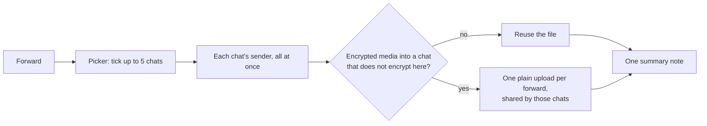
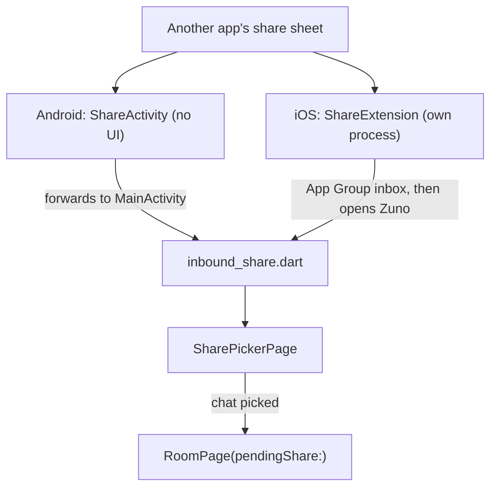

# Chats & Messaging

The chat room: its timeline, how each message is rendered, the composer,
attachments, voice messages, galleries, the media viewer, avatars,
forwarding and inbound share from other apps. There is no message model or service
layer: the chat reads and changes the SDK's `Room`, `Timeline` and
`Event` objects directly.
`RoomPage` keeps the timeline and wires the rest together; sending,
recording, typing, the menus and the message actions each have one owner
in their own file, and every widget lives in its own file.

## Components

Paths are under `lib/`. Files without a folder sit beside `room_page.dart`
in `features/chat/presentation/`.

| File | Role |
|---|---|
| `room_page.dart` | The live `Timeline`, read markers, pagination and the reply or edit state |
| `features/chat/data/room_sender.dart` | Every send in one room: progress, failed media, retries and temporary copies |
| `voice_recorder.dart` | The mic gestures and the recording |
| `message_actions.dart`, `attachment_menu.dart`, `room_menu.dart` | The message actions, the attach menu and the room menu |
| `features/calls/presentation/room_calls.dart` | Starting or joining a call from a chat |
| `message_list_view.dart` | The reversed list, its row memo and the upload and failed-send tiles |
| `message_tile.dart`, `message_bubble.dart`, `message_contents/` | One row, its bubble and each kind of content |
| `message_composer.dart` | The message box, recording row and reply or edit bar |
| `media_viewer/` | The full-screen viewer for the room's photos and videos |
| `features/chat/data/` | Sending, typing and unsent-message rules, and shared types such as `MessageRowData` |
| `core/matrix/event_display.dart` | What an event is, for every surface |
| `core/matrix/room_updates.dart` | Which room updates show, how they group and their wording |
| `core/matrix/image_send_preparation.dart`, `video_send_preparation.dart` | App-side media preparation before `sendFileEvent` |
| `core/matrix/attachment_cache.dart` | The only attachment cache, and the owner of every decrypted copy on disk |
| `core/matrix/attachment_actions.dart` | Share and save, over `core/share/outbound_share.dart` and `core/files/file_export.dart` |
| `core/matrix/media_audio_session.dart` | The one owner of the audio session |
| `core/matrix/mxc_avatar.dart` | Avatars |
| `core/matrix/media_gallery_group.dart` | Gallery grouping |
| `core/matrix/sanitize_message_html.dart` | The sanitizer for formatted (HTML) messages |
| `core/matrix/urls.dart`, `core/navigation/zuno_links.dart` | What counts as a link in a message, and the one link opener |
| `features/chat/data/forwarding.dart`, `forward_uploads.dart`, `forward_media.dart` | Forwarding: what the copy carries, the one upload per forward, and the flow from picker to summary note |
| `core/share/inbound_share.dart`, `features/share/` | Inbound share's `zuno/share` channel, and the chat list both pickers share |

## Timeline

- **SDK events are the state.** Each build derives runs, day labels and
  gallery membership from one pass over the newest-first event list.
- **A message rebuilds only when its record changes.** Each row gets a
  value-equal `MessageRowData`, and `RowMemo` (`app-foundation.md`) hands
  back the identical widget for an equal record, so Flutter skips it.
- **The page is quiet.** It rebuilds only when this room's state
  changes; timeline updates rebuild only the message list, and typing and
  read receipts only the parts that show them. Room changes wait while
  another page covers the chat or the app is in the background, then
  catch up with one rebuild (`app-foundation.md`). Values that change
  often, such as recording time and upload progress, are `ValueNotifier`s
  read by their own small widgets, and recording state redraws only the
  composer.
- **Opening.** The header and composer show at once. The timeline loads
  from the local database straight away but is applied only after the
  slide, so the slide never stutters.
- **Pagination** uses the `Timeline`'s own history requests. They fire
  on scroll-up and after every timeline update, because a room whose
  synced window filters down to less than a screen has nothing to
  scroll.
- **"Reload messages"** in the room menu swaps this room's local timeline
  for the server's latest page, with sync paused so no new message lands
  mid-swap. Nothing changes on the server. The room's history position
  resets with it; left stale, scrolling up resumes wherever history last
  stopped and the newest messages never return. Only joined rooms offer
  it, since the rebuild is stored as a joined-room update that would put
  a left room back in the chat list.
- **Reactions** allow one per person per message, a Zuno convention
  rather than a Matrix rule: picking another emoji redacts the old one,
  or discards it on this device if it never sent. While the old one is
  still on its way the pick does nothing, since a send in flight cannot
  be stopped. Double-tapping a message toggles a heart by the same rule.
  For a message outside the loaded timeline, which the media viewer
  reaches, the old one is looked up on the server, since the SDK gathers
  reactions only from the timeline it holds.
- **Double-tap holds every single tap inside a bubble** until the
  double-tap window closes, since Flutter's gesture arena cannot settle a
  tap sooner; widget tests that tap inside a sent bubble pump past
  `kDoubleTapTimeout`.

## Event display

`core/matrix/event_display.dart` is the single source of truth for what
an event is. The chat list preview, notification body, reply quote,
timeline filter and sender runs all call it, so no surface guesses on its
own.

| Function | Answers |
|---|---|
| `isDisplayableTimelineEvent` | Is it drawn in the timeline? Messages and room updates are |
| `isTimelineMessage` | Is it a message? Previews, notifications, unread counts and sender runs count only these |
| `summarize` | Its `MessageKind` and one line of text, for previews, quotes and notifications |
| `isPreviewableLastEvent` | Can the chat list show it as the last message? |

- **Visibility.** An edit is folded into its original by the `Timeline`
  and never drawn alone, and in-room verification is never drawn. Call
  signaling and state events that are not room updates show only with
  the show-hidden-messages toggle.
- **`MessageKind` switches have no `default`**, so a new kind fails to
  compile wherever it is not handled yet.
- **A new message shape is classified here only**, plus its iOS
  notification twin (`notifications.md`), and never special-cased in a
  surface.
- **Call summaries** are ordinary `m.room.message` events with Zuno
  msgtypes, classified here like everything else. Their body stays English in the room, since other clients display it; Zuno renders them in the phone's language.
- **A message reads as its latest edit wherever it is drawn or acted
  on**, with its own ID, sender, time and send state, so the chat, the
  long-press sheet and the viewer agree and an edited photo is never two
  items. The original's gallery link and forwarded mark stay, because an
  app that knows neither drops them from its edits; only the edit's own
  send state and retry use the edit itself.
- **Live location starts** are `m.room.message` events with a Zuno
  msgtype too. Their tile draws the live share while it runs and reads like
  a deleted message once it ended, and deleting your own stops its share
  first (`location-sharing.md`).
- **Copy is offered on text messages only**, because any other kind's
  text is a fallback for other clients, not what its bubble shows.

## Room updates

Membership changes, the room's creation, name, topic and photo, and role
changes are drawn for everyone as centered pills. `isRoomUpdate` is the
one rule for what counts.

| Shown | Never shown |
|---|---|
| Joined, left, invited, declined, withdrawn invitations, removed, banned, unbanned, asked to join | A member changing their own name or photo |
| Room created; name, topic and photo set or removed | History visibility, guest access, address, join rules, encryption, upgrades |
| A member's role changing | Permission changes that change no one's role |

- **One-to-one chats show only someone leaving, being removed or being
  banned**, so a chat starts clean and still says when messages stop
  reaching the other person.
- **Bursts.** Updates in a row, with no message between them and on one
  day, are one row. It holds one sentence per kind of change and actor,
  with the people merged ("Alex invited Sam, Lee and Mia", then a count
  past three names). A burst is keyed by its oldest event, so a live
  update grows the row in place.
- **Merging rules.** Only the final name, topic and photo of a burst
  show, each person's final role shows, joining then leaving reads as one
  change, and the creator's own first join is hidden behind "created the
  room".
- **The reader is "you"**, as actor ("You invited Sam"), as target
  ("Alex removed you") and for their own role ("You are now an admin").
- **The kind of membership change needs `prev_content`.** The SDK's
  `roomMemberChangeType` reads it to tell a join from a profile change or
  a kick from a withdrawn invitation; without it a leave stays hidden.
- **Role changes are a diff** of each user's role in the previous and new
  power levels, so the room's first power levels, which have no previous
  version, never show.
- **A topic change does not repeat the topic**, since topics are long; a
  pill stops at three lines.
- **Wording is translator-safe.** Each kind is a whole sentence; names
  come from fixed two-, three- and many-name patterns, and a count drives
  verb agreement in every language.
- **The empty-room notice stays** above the updates until the first
  message.

## Rendering

- **Runs.** Messages from one sender on one day, sent close together,
  form a run; in a room, the name and avatar show on its first message.
- **The time row tucks into the last text line.** The paragraph ends with
  an invisible twin of the row, and the visible row sits over it. If the
  twin does not fit, the paragraph wraps it, and the row lands below the
  text with no extra code.
- **Formatted (HTML) messages** pass through `sanitizeMessageHtml` and
  are drawn by `flutter_html`. The sanitizer drops the reply fallback,
  scripts, forms, images and media with their contents, keeps an
  allowlist of formatting tags and only safe external links, and turns
  `@room` and user pills into highlighted names rather than links. It
  marks mentions in its single pass over the parsed tree, never by
  matching the HTML string, so markup inside an attribute never comes
  alive. They cannot reserve room on their last line, so their time row
  sits below.
- **Links.** Plain and formatted messages share one rule for what may
  open (http, https or mailto with a target) and one opener, which says
  where to go when no app can open the link. Trailing sentence
  punctuation and a closing bracket the link did not open are not part
  of a link.
- **"edited"** shows only when the drawn text comes from an edit, and
  the SDK takes edits only from the message's author, so an edit from
  anyone else changes nothing.
- **Images decode at display size.** A bubble, gallery tile, reply quote
  or media grid cell decodes so the shorter side fills its box and the
  longer side stays bounded, never enlarged. The media viewer decodes a
  photo to the screen's size and switches to full size once it is zoomed,
  showing the screen-size picture until the full one is ready.
- **A blurhash stands in until the picture is on screen.** A received
  photo or video thumbnail shows the event's `xyz.amorgan.blurhash`, laid
  out at the media's own size, until its first frame paints, so there is
  no blank gap between download and decode. Thumbnails never spin (no
  blurhash means their empty box); the media viewer adds a spinner, and a
  failed photo or video says so with Try again.
- **One image provider downloads and decodes each attachment**
  (`CachedAttachmentImage`), keyed by event, so a decoded picture survives
  rebuilds and byte-cache churn. A failed download is tried again when the
  connection comes back, when the image is shown afresh or on Try again;
  one that downloaded but cannot be decoded is not.
- **A message sent in clear wears a red lock badge** straddling its
  bubble's top corner on the side facing the middle of the screen, clear of
  the avatar and the reactions. It sits level with the bubble's top, so it
  never adds space or reaches the message above. What counts as sent in
  clear: `security-verification.md`.
- **Reply quotes** fetch their target once per room visit through
  `getEventById`, which decrypts a stored event with the keys held now. A
  target still encrypted goes to the app-wide late-key watcher, which opens
  it when its own key arrives (`security-verification.md`), so its quote
  fills in without reopening the room.

## Composer and sending

- **Text goes out as typed.** Enter inserts a new line and only the
  button sends. Markdown and commands are off (Decisions).
- **Mentions.** The picker inserts the SDK's own mention fragment
  (`@Name`, or `@[Full Name]`), the only shape `sendTextEvent` turns into
  `m.mentions`. The full member list is fetched at most once per room per
  session, and only when someone types a mention.
- **Editing** sets the draft aside and puts it back when the edit is sent
  or cancelled.
- **Recovery code check.** Sending what looks like the recovery code asks
  for confirmation first (`security-verification.md`). It warns rather
  than blocks, since blocking would also stop someone saving it to their
  own notes.
- **Voice recording.** Holding the mic records and releasing sends; a
  short press locks recording on, and sliding up cancels. The message is
  an audio file marked as voice (MSC3245) with a duration and waveform.
- **A press that has to ask for the microphone only asks**, and the next
  press records, because the system prompt takes the touch away
  mid-gesture.

## Unsent messages

An own message is sending until the server takes it, and not sent once
the SDK gives up. Until then it has only a local ID, which no other
client can resolve.

- **Reply, react and edit act only on a sent message**, swipe-to-reply
  and double-tap included, because each points at its target by an ID
  other clients must resolve.
- **The actions sheet shows the real send state**: not sent, sending, or
  the time it was sent.
- **Failed sends** show as not sent with tap-to-retry, and a reconnect
  pass resends them oldest first. It scans the timeline for unsent own
  events rather than tracking transaction IDs, because the SDK can also
  give up silently on a long 429 with no exception. Failed media sends
  are their own tiles, kept by the room's sender, so they wait in the
  chat for a retry after you leave it.
- **A failed edit** shows as not sent on its message and resends as an
  edit. An edit a newer one replaced, or whose message was deleted, never
  resends.
- **Reactions resend as reactions**, because the SDK's own resend sends
  everything as a message.
- **Anything whose upload already finished resends its content as is**,
  because the SDK's own resend uploads attachments again from its file
  store, which is off, and drops the row when it finds nothing there.

| Delete on | Does |
|---|---|
| A failed message | Discards it on this device only, since the server never had it |
| An attachment still on its way | Stops its upload, so nothing reaches the server |
| Text still on its way | Not offered, because a message post in flight cannot be stopped |
| A gallery | Always offered; while its batch still sends, the rest of the batch stops |
| One item of a batch that shows on its own | Deletes that item; the rest of the batch still goes |

- **A deleted item past its upload is deleted once it lands**, a resend
  after a restart included.
- **A stopped send keeps running inside the SDK**, which has no cancel:
  it retries for up to its one-minute window and can publish the row
  again, so the room's sender removes it each time until the SDK gives
  up.
- **Deleted sends are remembered per account across restarts**, so a
  leftover unsent item is dropped when its chat opens and never resent.
  The record is pruned against the chat's unsent items and cleared by the
  sign-out wipe (`app-foundation.md`).

## Attachments

### Preparation

Media send is app-side: the SDK's image shrink is bypassed, and the
prepared file, thumbnail and blurhash go to `sendFileEvent`.

- **Photos** are resized natively to a long-edge cap, smaller with
  "Reduce media size" (on by default). PNG stays PNG; anything else,
  including an animated GIF, becomes a still JPEG.
- **Videos** are probed natively, then remuxed losslessly when they are
  already H.264 near the target size and bitrate, or else re-encoded by
  `light_compressor`.
- **Files** from the file picker go byte-for-byte with their own names.
- **Shared files** are typed by the SDK's own rule: the type the sending
  app declared, else one guessed from the name and header bytes. Photos
  and videos then go through the caption screen and preparation, so a
  shared image loses its metadata even when the sending app gave no
  type; anything else goes byte-for-byte with its name and that type.
- **One dispatch** picks the caption screen for the camera, the gallery
  picker and inbound share alike, and more than one item becomes a
  gallery.

| Step | Android | iOS |
|---|---|---|
| Photo resize (`zuno/image`) | `ImageResizer.kt` | `ImageResizerPlugin.swift`, ImageIO |
| Probe, remux, thumbnail (`zuno/video`) | `VideoTools.kt`, `MediaMuxer` | `VideoToolsPlugin.swift`, AVFoundation |
| Re-encode | `light_compressor` | `light_compressor` |
| Voice recording | Ogg Opus directly | CAF, repackaged to Ogg Opus |
| Keeping a send alive | A dataSync foreground service with a progress notification | A short background task, with no progress surface |
| Playing cached files | As they are | Needs a type: a `.<ext>` symlink or the MIME type |

Both native sides give the same replies on each channel, with codecs
named the Android way.

### Send flow

- **Arrival.** While Android copies a picked file in from its provider,
  the attach button spins; iOS's document picker shows its own download
  progress and sends no signal.
- **Progress.** One bar per attachment, filled first by compression and
  then by upload. The SDK reports no upload progress and `sendFileEvent`
  takes no callback, so `UploadHttpClient` slices the request body itself
  and reports to the send it runs in through its `SendScope`. A full bar
  means the body is handed to the socket, not that the server has it.
- **A stuck send fails instead of hanging.** An upload, media-limits
  fetch or message post with no progress for 30 s is aborted
  (`app-foundation.md`), then shows as a retry tile or as not sent.
- **A send remembers the network error it hit**, because the SDK swallows
  it once its retry window ends and reports only that the send failed, so
  a failed send or forward can still say to check the connection.
- **The pending tile.** A synthetic tile, matched later by `txid`,
  stands in until the real row exists. Both draw the preview from memory
  until the upload finishes, because the SDK has no thumbnail for a
  pending event.
- **Temporary copies.** Inbound share and both pickers leave a copy of
  each file in the app's temporary storage. The room's sender owns them
  all and deletes each once it is sent or dropped, or sent files pile up,
  but keeps it while a failed photo or video can still be retried, until
  sign-out.
- **Sending outlives the chat screen.** Each room has one sender, living
  until sign-out, so leaving mid-batch still sends every item and shows
  any error, and progress and failed items are still there when the chat
  opens again. A failure while the chat is closed also says so.

### Attachment cache

The SDK's own file store is off, so `attachment_cache.dart` is the only
cache, with one key per event. It owns every decrypted copy Zuno writes to
disk, share and save copies included, so expiry, the size budget and
sign-out reach them all.

| Helper | Tiers | Used for |
|---|---|---|
| `fetchCachedAttachment` | Memory, then disk, then network | Images and thumbnails |
| `fetchCachedAttachmentFile` | Disk, returning the file itself, filled from a memory copy when there is one | Videos, voice messages and files, so nothing large is held in memory or re-downloaded |
| `fetchCachedAvatar` | A disk tier that never expires | Avatars |
| `fetchAttachmentHandover` | A fresh copy of the disk file | Each share or save |

- **Attachments expire a day after last use**, so decrypted media does
  not linger. Avatars never expire, because an `mxc` address is immutable
  and a new avatar is a new address.
- **A sweep bounds the disk by total size**, evicting the least recently
  used, at app start and after writes. Of the files larger than the whole
  budget, only the most recently used stays, until it expires; an avatar
  that large goes at once, since it would never expire.
- **Each share or save gets its own hand-over copy**, outside the size
  budget and expiring by age only, because the receiving app may still be
  reading it. Save deletes its copy once done.
- **Writes are atomic** (a temporary file, then a rename), so a reader
  never meets a half-written file.
- **A download still in flight at sign-out is dropped when it lands**, so
  it never writes the old account's media to disk.

### Share and save

- **Saving a file exports its hand-over copy natively on both platforms**
  (`zuno/files`), so no plugin writes a copy of its own, and Android
  streams it into the chosen document instead of holding it in memory.
  Photos and videos go to the gallery instead.
- **On Android, sharing out goes through Zuno's own chooser and a
  `FileProvider` that exposes only the hand-over copies**, and Zuno leaves
  itself out of that chooser, since inbound share refuses its own files.
  iOS uses the system share sheet.
- **A startup cleanup deletes the plaintext copies older builds left in
  temporary storage**, which nothing else expires. It is temporary code,
  kept until no install still runs one of those builds.

### Galleries

A batch of more than one item gets a gallery ID, and each item goes out
as a normal `m.image` or `m.video` carrying
`im.zuno.gallery: {id, index, count}`. On display, `groupGalleries`
groups by sender and gallery ID, so nobody joins another person's
gallery by reusing its ID, and folds each group onto its newest member,
so the per-index passes (read ticks, day labels, runs) keep working. A
group with one surviving member, or an unrecognized key, renders as an
ordinary item, unless its other items are your own failed sends, which
keep their retry tiles in the gallery. Share, save and delete on a
gallery act on every item, and deleting a gallery whose batch still
sends stops the batch (Unsent messages).

### Audio session

One owner sets the audio session for voice messages, video sound, iOS
recording and iOS chat tones (`media_audio_session.dart`).

- **Voice plays with a speech profile and video with a film profile.** A
  video holds the session only while it plays with sound, and starting a
  voice message pauses a video, and the other way round.
- **Playing pauses other apps' audio and hands it back when it stops**, so
  music resumes. An interruption or unplugged headphones pause playback
  before the session goes back.
- **During a call, playback goes where the call plays** and the session is
  left alone.
- **iOS recording goes through it** because the recorder never gives its
  session back; Android's recorder holds its own focus
  (`recorderNeedsAudioSession`).
- **An iOS chat tone holds an ambient session only while it plays**, so it
  follows the silent switch and mixes with other apps' audio, and plays
  inside a voice message's or video's session when one is held
  (`tonesNeedAudioSession`); Android's tones need no session
  (`notifications.md`).

### Avatars

- **One request per person per size bucket.** With two buckets, one
  person costs at most two requests however many sizes show them, and the
  notification poster reuses the small one.
- **Initials** sit on a tone hashed from a stable Matrix ID, never the
  display name, so a rename keeps the color and nobody changes color
  between screens. Changing the hash recolors everyone.
- **A room's tone follows whoever it shows:** an unnamed invite takes the
  inviter's ID, a direct chat its partner's, any other room its own, so a
  direct chat matches its partner everywhere, the call screen included.
- **A failed load is evicted and its bytes deleted**, or one bad
  response would break a never-expiring entry for good.

## Media viewer

One viewer (`media_viewer/`) opens every photo and video, from a chat
bubble, a gallery tile, Room info's preview or the Media page. It pages
through the room's sent photos and videos, never files, in time order,
starting at the tapped item. Every opener hands it the chat's room, live
timeline and reply and edit starters, so Room info and the Media page reach
the chat too.

- **The room's media feed is the source** (`rooms-membership.md`). The
  tapped item shows at once, alone until the feed has loaded back to its
  send time; then its neighbors appear.
- **Older items load near the oldest edge.** After a failed or empty page
  only a swipe at that edge tries again (`rooms-membership.md`).
- **The item on screen never jumps.** New media, older pages and deletions
  apply only while the pager is idle. A deleted item on screen gives way to
  a neighbor, and the viewer closes when nothing is left.
- **A video reached by swiping loads only when played**, so swiping past
  videos costs no data; one opened directly plays at once. Swiping away
  pauses it, and mute holds for the whole visit.

Frosted controls float over the media, which stays centered on the whole
screen: back, the sender with the send time and ⋯ at the top; the caption,
the gallery position, a video timeline with mute, reaction chips and an
action pill (React, Reply, Forward, Share, Save) at the bottom. They hide
on their own while a video plays. The caption shows the item's latest
edit.

| Action | On a gallery item, acts on |
|---|---|
| React, reaction chips, ⋯ | The gallery message, the one the chat shows reactions under; ⋯ opens the gallery's sheet |
| Reply, Forward, Share, Save | The item on screen, so a reply quotes that exact photo |

- **⋯ opens the same sheet as long-pressing the message**, and React and
  Reply follow its rule: shown only where the user can post and the item
  is sent.
- **Reply and Edit return to the chat**, closing every screen above it (the
  viewer, the Media page, Room info), and start in the composer.
- **Reaction chips** show every reaction with its count, the user's own
  highlighted, and the React button shows the user's own. For an item
  outside the chat's loaded timeline the viewer fetches reactions from the
  server, every page, and again after the user reacts.

| Gesture | Effect |
|---|---|
| Tap | Hides or shows the controls and the system bars |
| Swipe sideways | The next or previous item; off while zoomed |
| Swipe down | Closes; the chat shows through while dragging |
| Double-tap or pinch a photo | Zooms |

- **A video pauses while a full page covers the viewer or the app is in
  the background, and plays on after**, so its sound never runs behind the
  forward picker; a sheet over it leaves it playing.
- **Opening flies the photo from its thumbnail, and closing flies it
  back.** Only the opened item flies back; one reached by swiping fades
  out. With reduced motion the viewer appears and leaves at once.

## Forwarding

Photos, videos and files (stickers count as photos) forward to up to 5
chats with one Send; voice messages, text and locations do not. The
long-press sheet offers Forward, or Forward all (N) on a gallery, counting
only its sent, readable items; the viewer's Forward sends the item on
screen. The user stays where they were and gets one note: sent to every
chat, or which chat failed.

- **The picker is the inbound-share chat list with ticks**: the same
  chats in the same order, the red open lock on unencrypted ones, and a
  community's avatar in the corner of each of its chats. A sixth tick is
  refused, and a ticked chat that stops being eligible drops out.
- **From an encrypted chat, ticking an unencrypted one shows a note above
  Send**, with no extra confirmation.
- **The copy is the message as it reads now, with nothing pointing back**:
  replies, threads, formatting, mentions and the original gallery link are
  dropped, it carries an empty mention list so the caption pings nobody,
  and it is marked `im.zuno.forwarded: true`. A forwarded gallery gets a
  new gallery ID in each chat.
- **An encrypted file's key never reaches a chat that will not encrypt
  it.** Into a chat that encrypts on this device the file is reused, its
  key travelling inside that chat's encryption; anywhere else the file and
  its thumbnail are uploaded again unencrypted, each only if it was
  encrypted. A thumbnail that cannot be fetched is left out.
- **The re-upload runs once per forward**, shared by every chat that
  needs it, so five unencrypted chats cost one download and one upload.
  Those chats show a progress tile meanwhile, and the copy can be deleted
  once it lands.
- **Each chat's own sender sends its copy**, so deleting a copy still on
  its way works as for any send. A copy the server refused shows as not
  sent and resends as is; a failed re-upload waits as a retry tile in that
  chat. The senders stay quiet; the summary note is the only note.
- **Other apps show an ordinary media message.** Zuno draws a "Forwarded"
  label above the media, with the reply arrow mirrored, which is also the
  Forward icon everywhere.

## Inbound share

Both platforms hand Dart the same payload over `zuno/share`: optional text
plus file URIs with names and MIME types. Dart asks native to copy the
files (`copyToCache`) only after a chat is picked.

- **The picker** lists the chats the person can post in, through the same
  chat list as forwarding, whose search matches the name each row shows
  (`rooms-membership.md`). Picking one
  opens `RoomPage(pendingShare:)`, which prefills the text, never sending
  it automatically, and then copies and sends the files. One share goes
  to one chat.
- **On iOS** the extension copies each attachment into the App Group
  inbox before it closes, and the app collects the inbox on activation.
  The URL it opens carries nothing, so a cold start needs no URL
  handling, and an unopened share expires so it never pops up later.
- **On Android only `content:` files from another app's provider are
  read, never from a provider Zuno owns**, so a share can never make Zuno
  send its own private files.
- **Not built**: Direct Share targets in the Android share sheet. They
  would be additive and could reuse the pinned-shortcut code.

## Decisions

- **Text goes out as typed.** Every `sendTextEvent` call passes
  `parseMarkdown: false, parseCommands: false`. The SDK has no
  client-wide switch, so a new call site must pass both, and commands off
  is a safety rule: the SDK's commands include `/leave` and `/ban`.
- **Drawn, previewed and counted are three questions** in an encrypted
  room, and a fix to one does not answer the others. The server counts
  unread from the encrypted envelope, so no filter over decrypted content
  can match it. Hence any event the server issued can carry the read
  marker: receipts are cumulative, so over-including is free, while
  under-including leaves a badge that never clears.
- **A read marker goes only to an id with the `$` sigil**, whether the
  chat, the chat list or a notification sets it (`read_receipts.dart`).
  The SDK makes up synced events with local ids, such as the redaction
  it adds when an unsent last message is cancelled, and the server
  rejects the whole marker for one of those.
- **Galleries are a content key on ordinary events**, so other clients
  see normal messages, and forward, redact and download work with no new
  code. One multi-item event and time-window grouping were rejected.
- **One media viewer for every entry point**, not separate photo, gallery
  and video viewers, so their controls and actions never drift apart.
- **The media viewer shows no overall position** ("12 of 120"), because
  the room's total is unknown until all history has loaded; a gallery item
  shows its place in its gallery instead.
- **Media never falls back to the original bytes.** A failed photo or
  video preparation refuses the send, because the untouched file leaks
  metadata. The SDK's resizer sends the original when it fails, which is
  why preparation is app-side.
- **No location leaves with media.** Sent media gets generic names, since
  original names carry timestamps, and the native resizers and encoders
  write no location. Files from the file picker, and shared files that
  are not photos or videos, stay byte-for-byte by design.
- **Video bitrate is fixed by output size**, never a fraction of the
  source's, because a fraction of a 4K clip's bitrate still makes a file
  too large for the server.
- **Voice is Ogg Opus on every platform**, mono at a speech bitrate.
  Apple cannot write Ogg, so iOS records CAF and repackages the packets
  losslessly before sending.
- **Mentions ride on the event, never on a member list.** Only
  `m.mentions` earns a highlight push and decides what is highlighted. No
  `matrix.to` pill is written, so other clients show the fragment as
  plain text.
- **Inbound share is a trampoline on Android and an inbox on iOS.** A
  `SEND` delivered straight to `MainActivity` would start a second
  Flutter engine in the sender's task, so `ShareActivity` forwards it
  with `NEW_TASK | CLEAR_TOP | SINGLE_TOP`, like every intent that opens
  the app (`app-foundation.md`). Share plugins were rejected because they
  want `singleTask`, which calls and the lock-screen ring were tuned
  against. The iOS extension is its own process with no engine, so it
  must copy before it closes.

## Gotchas

- **A stale record is a stale message**, so anything that changes a
  message's look joins `MessageRowData`, with a test.
- **The keyed list needs `findChildIndexCallback`**, or a new message
  remounts every visible row, stopping a playing voice message.
- **`Text.rich` already scales its `WidgetSpan` children**, so the
  invisible time twin opts out of text scaling, or it is scaled twice.
- **Nothing under a reply-quote bubble may be `double.infinity` wide**,
  because its `IntrinsicWidth` pass throws and shows a blank grey box.
- **A rounded `BoxDecoration` with a non-uniform `Border` throws at
  paint time**, so accent edges are separate strips in a `Stack`.
- **The send/mic swap is keyed on the button, not the icon**, because a
  key change mid-gesture kills the hold-to-record pointer stream.
- **Never load members from `onRoomState`**: loading members fires it
  once per member, and the re-entrant chain starves the main isolate.
- **The member fetch is one `database.transaction` that never throws**,
  because the SDK does not reset its batch on error.
- **The SDK resolves mentions by display name**, so a member without one
  gets plain text, with no `m.mentions` and no push.
- **A failed history request latches history off** until the next
  successful sync, because the SDK fires an update even on failure and
  the update trigger would ask again at once.
- **Never render `Event.body`**, which can be empty or a raw fallback;
  use `plaintextBody`.
- **Undecryptable means still `m.room.encrypted`**, checked with
  `isUndecryptableEvent`, and the SDK's decrypt error text is never shown
  (`security-verification.md`).
- **`room.lastEvent` can be an edit, hidden signaling or an encrypted
  envelope**, so the newest real message is resolved through
  `isPreviewableLastEvent` and `summarize`.
- **`room.lastEvent` changes identity, not ID**, so a cache of it must
  compare instances, or a deleted message keeps its text.
- **Keep `roomPreviewLastEvents` narrowed** in `createMatrixClient()`,
  because the SDK default includes call signaling that has no bubble.
- **A video without a thumbnail never calls `getThumbnail`**, which
  silently downloads the whole file and then fails to draw it.
- **The encoder takes raw sensor orientation**, so the target size is
  swapped only when the probe reports a rotation flag, and an upright
  portrait screen recording keeps its shape.
- **`light_compressor` refuses sources under 2 Mbps** unless its minimum
  bitrate check is off, and takes whole megabits only.
- **Android 12+ refuses foreground-service starts from the background**,
  so the upload service is acquired once per send while the app is
  visible, and honors Android 15's dataSync `onTimeout`.
- **just_audio reports a pause before the native player stops**, so the
  session goes back only after an awaited pause, or iOS refuses to
  deactivate it under running audio.
- **just_audio's `play()` completes only when playback stops**, so it is
  never awaited, and a second load interrupts the first, so taps share one
  load.
- **just_audio's `dispose` only finishes in widget tests when the fake
  clock is pumped**, so tests unmount a voice message with pumps, not real
  async.
- **Video players are created to mix with others**, so Android's player
  never takes audio focus itself; otherwise it and the session owner take
  focus from each other and each pauses the other.
- **A media hero's tag pairs the opening screen's route with the event**,
  or the same photo in the chat and in Room info would fly between those
  two screens on every push and pop.
- **Share and Save hand over one folder per attachment**, because names
  repeat: every photo Zuno sends is `photo.jpg`.
- **Cache expiry deletes are fire-and-forget**, because two readers can
  meet the same stale entry and the loser's delete would throw.
- **A temporary copy is deleted only if it lies inside the app's
  temporary storage**, with its folder once empty, so an original or the
  storage itself is never touched.
- **The picker's "done" signal can arrive after the pick has returned**, so
  the attach spinner ends with the pick itself.
- **Link and mention scanning stays linear in the message's length**,
  because anyone can send a message built so that a backtracking pattern
  or a repeated trim stalls the chat.
- **Shared file names are attacker-controlled**, so both native sides
  strip separators, reject `.` and `..`, cap names at the filesystem's
  255 UTF-8 bytes keeping the extension, and refuse paths outside their
  share folder; keep the Kotlin and Swift checks in step.
- **The iOS share extension cannot cold-launch a debug build**, so test
  sharing into a closed app with a profile or release build.

## Testing

`RoomPage` runs on `room_page_harness.dart` (never `pumpAndSettle`). The
harness settles the sign-in state before opening the page, as the app
does, because the room's sender resets when it changes.
