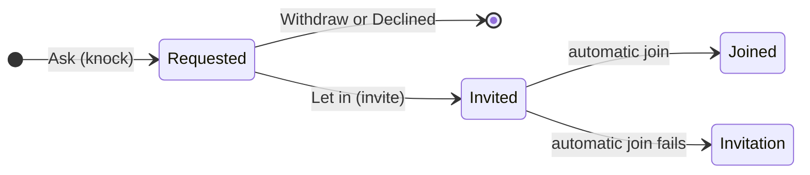

# Communities

Matrix spaces, called communities in the app: a family, club or team with several rooms. Home has two tabs, Chats and Communities, and both are fed by one split of `client.rooms` per sync. Ask to join (Matrix knocking) lives here too. The chat list itself, room access and roles are in `rooms-membership.md`.

## Architecture

| Piece | Role |
|---|---|
| `core/matrix/rooms/communities.dart` | `arrangeHome` splits the rooms once per sync, and one result feeds both tabs and the unread dots in the bottom bar. The file also holds community creation and leaving. |
| `core/matrix/rooms/joinable_rooms_feed.dart` | The rooms `CommunityPage` offers to join, read from `/hierarchy` a page at a time. |
| `rooms/presentation/home_bottom_bar.dart` | The tab pill, with the + button beside it. Only the visible tab is built. |
| `ChatListView` | One list widget for both tabs, its section picking the feed. On Communities, each joined community is a card (`SliverCardGroup`): a heading that opens the community, then its rooms as compact `ChatRow`s, or a line saying none are joined that also opens it. |
| `communities/presentation/community_page.dart` | The header, your rooms, joinable rooms, members with their roles, and the community's settings, permissions and leave. Its rooms long-press into the same sheet as the home tab (`room_actions.dart`). |
| `core/matrix/rooms/membership/join_requests.dart` | Ask to join, for both the requester and the approvers. |

`arrangeHome` produces five buckets:

| Bucket | Contains | Shown in |
|---|---|---|
| Chat invitations | Invitations to rooms that are not communities, except approvals of your own join requests | The Chats tab |
| Chats | Joined rooms that are not communities and that no joined community holds | The Chats tab |
| Community invitations | Invitations to communities | The Communities tab |
| Communities | Joined communities, ordered by the activity of their newest room | The Communities tab |
| Community rooms | The joined rooms each community holds, except direct chats, newest first | Its community's card and `CommunityPage` |

**Flows**
- **Joinable rooms.** `/hierarchy`, one level deep, a page at a time: the first page when the page opens and on pull to refresh, the next as the end of the list comes into view, and nothing at all when the community lists no child you have not joined. A page with nothing new to join loads the next at once, so the list never waits on a spinner nobody can scroll to. Tapping a room opens its details from that listing (`joinable_room.dart`), with the same Join or Ask as its row.
- **New community.** One `createRoom` call with the space type and the community's power levels. A public community is listed in the same call, so a server that refuses the listing creates nothing.
- **New room in a community.** The room carries its join rule and `m.space.parent` in its initial state, and then the community gets an `m.space.child` event. If that second write fails, the room exists outside the community, and the user is told so.
- **Directory.** The server filters by room type: Find public communities asks for spaces only, and Find public rooms for rooms without a type.

**Ask to join**

A joinable room shows Join when its join rule is not `knock`, and Ask or Requested when it is.

## Decisions

- **A community holds the rooms it lists** (`m.space.child` with a `via`), as Matrix and other clients read it, so a room another app added one way stays under the community once joined. This rule decides home placement, the community page, share badges and what leaving takes along.
- **Opening a room to a community needs both links**: the room must also name the community (`m.space.parent`), because that grant changes who can join and needs the room's own side.
- **A community card's heading has no preview or unread count**, because each room under it shows its own.
- **A room held by two joined communities shows in both cards**, since each card lists everything its community holds.
- **Chats never shows a community or a room a joined community holds.** A direct chat listed in a community stays in Chats, and so does a room whose community you have not joined.
- **A community is Public or Private**, and its access works like a room's.
- **New communities lock everything except rooms and invites.** Settings and messages are admin-only, adding rooms needs a moderator, and any member can invite.
- **A community room is Community, Ask to join or Private, never Public** (what each maps to: `rooms-membership.md`). This is an app rule only, so another client can still publish such a room.
- **Leaving a community also leaves the rooms that no other joined community holds**, and the confirmation says how many and warns when you are the last admin of the community or of a room leaving with it.
- **Rooms inherit neither roles nor access.** Matrix has no inheritance, so community admins are not admins of its rooms.
- **Only moderators and admins answer requests**, because declining is a kick, which Zuno's default levels give to moderators and up.
- **An approved request is joined automatically.** Zuno remembers which rooms you asked for, and while a request is pending its approval is not shown as an invitation. If the automatic join fails, the approval shows as a normal invitation.
- **Approvers are notified only while Zuno runs**, because there is no push rule for knocks.

## Gotchas

- **A space never opens a timeline**, so `CommunityPage` calls `postLoad()` itself, since topic, join rule and power levels are not loaded at cold start.
- **The SDK never creates a `Room` for your own knock**, so the requested state is Zuno's to keep.
- **`requestParticipants` caches members only in encrypted rooms unless asked to**, so the knock lookup asks explicitly.
- **Removing someone from a community leaves them in its rooms**, and the dialog says so.
- **Matrix removes a room from a community by emptying its link**, so only a link with a `via` counts.
- **The server forgets a `/hierarchy` position after a few minutes** and refuses it with `M_INVALID_PARAM`, so the list starts over and skips the rooms already shown.
