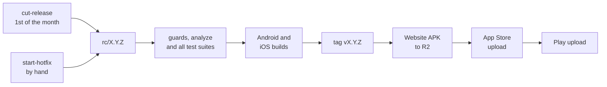

# Releases

Releases to Google Play, the App Store and the website's APK download are
automated. On the 1st of each
month, everything on `master` since the last release is tested, built,
signed and submitted straight to production for every user at once, with
no human step; any failure stops the release. Hotfixes run through the same pipeline when
started by hand. Commit subjects decide the version, and a draft file
supplies the store notes.

The logic (versions, build numbers, commit types, guards) is pure Dart in
`tool/release/`, the store work is in `fastlane/Fastfile`, and the website
upload is a job in `release.yml`.

## Commit types and versions

- **The commit type sets the version.** Minor if any `feat` landed since
  the highest tag, else patch if any `fix` did, else no release that month.
  Major is manual.
- **Every type in a combined subject counts** (`chore: …; fix: …`).
- **`feat` must mean user-facing.** Tooling filed under `feat` forces a
  minor release, so it belongs under `chore`.
- **Build number**: MAJOR×1,000,000 + MINOR×1,000 + PATCH, the same on both
  stores. MINOR and PATCH stay at 999 or below, and MAJOR at 2099 or below
  (Android's version-code ceiling).
- **One build per version**, so a binary a store rejects ships as the next
  patch.
- **Notes**: at the cut, `docs/release-notes/next.txt` becomes `X.Y.Z.txt`
  and a fresh empty `next.txt` takes its place. The notes must be non-empty
  and at most 500 characters (Play's limit), or the cut stops.

## Workflows

| Workflow | Trigger | Does |
|---|---|---|
| `cut-release` | Cron on the 1st, or by hand | Computes the version, commits `chore: release X.Y.Z` (pubspec bump, notes moved) to `master`, pushes `rc/X.Y.Z` and dispatches `release` |
| `start-hotfix` | By hand, with master commit SHAs and notes | Branches `rc/X.Y.Z` from the highest tag as the next patch, cherry-picks with `-x`, commits the bump and notes on the rc branch, dispatches `release` |
| `release` | Dispatch, on `rc/*` only | Guards → analyze and the Dart, Kotlin and Swift suites → both builds → tag `vX.Y.Z` → website APK → iOS upload → Android upload |

- **The release branch name is the version.**
- **The tag spends the version before any channel holds its binary**: it
  is pushed once both builds pass and before any upload, so no channel ever
  holds an untagged version and a re-cut never resubmits an old binary.
- **The guards** fail if the tag exists, if the version is not above the
  highest tag, if the pubspec disagrees, if the notes are invalid, or if a
  fix shipped in another tagged release (by its cherry-pick source) is
  missing from HEAD, so a release never drops a fix users already have.
- **Uploads run most reversible first**: the website (its manifest can be
  pointed back), then iOS (a submission can be withdrawn), then Play (a
  production commit can only be halted).
- **No staged rollout**: Play ships at 100% and iOS skips the phased
  release, so a bad release reaches everyone and the fix is a hotfix.
- **The next monthly cut skips commits named in a `cherry picked from`
  trailer**, so a fix shipped as a hotfix is not counted twice. Take a
  shipped hotfix's fixes off the bug count in `next.txt` for the same reason.
- **`start-hotfix` stops before pushing anything** when a commit is not on
  `master`, is a merge commit (pass the commits it merged instead), fails or
  conflicts on the pick, or when the base already has every change.
- **Dry run**: dispatch `release` on `rc/dry-run` with `dry_run`. It runs
  the full gate, both signed builds, store validation and a website upload
  to a scratch folder it then deletes, and pushes no tag.
- **Third-party actions are pinned to commit SHAs**, so a moved tag cannot
  change what a release runs, and Dependabot bumps them; GitHub's own
  `actions/*` stay on major tags.

## Website APK

- **One signing identity**: Play App Signing uses our own key, the one CI
  signs the website APK with, so website and Play installs update each
  other; a different key would force an uninstall, wiping the session and
  E2EE keys.
- **The Android build fails unless the APK carries the pinned certificate**,
  because the website upload runs before Play could catch a wrong key.
- **The website's contract is `android/latest.json`** in the R2 bucket,
  uncached: the current version, the APK's path relative to it, its SHA-256
  and size. Each version's APK is its own immutable object, uploaded before
  the manifest so the manifest never points at a missing file.

## Environments

Secrets live in the `release` GitHub environment, restricted to `rc/*`:
`.env`, `google-services.json`, the keystore, the store keys, the match
secrets and the R2 credentials, plus the keystore's certificate fingerprint
as a variable. CI writes the gitignored inputs from these secrets and fails if one is missing, since the build would otherwise ship
green without FCM or crash reporting.

## Recovery

| Case | Do |
|---|---|
| A gate or build fails | Nothing was tagged or uploaded. Fix on `master`, `git cherry-pick -x` onto the rc branch, re-dispatch `release` |
| An upload fails | "Re-run failed jobs", never "Re-run all jobs": the guard refuses a tagged version. A build Apple already holds is that run's, so the iOS lane submits it without re-uploading |
| A store rejects the binary | The version is spent. Ship the fix as the next patch through `start-hotfix` |
| A bad release is live | Halt the Play release, which works at 100% too, then `start-hotfix`. iOS has nothing to pause |
| `cut-release` failed partway | Re-run it. It resumes without dropping new notes |
| A failed rc is still untagged on the next 1st (a gate or build failure) | The cut fails on the name clash. Delete the stale branch |
| A run is abandoned after its tag | Nothing. The version is spent and the next cut moves past it |

## Gotchas

- **A real release's failure emails nobody**, because the bot dispatched it,
  so check Actions after the 1st and after a hotfix.
- **A hotfix must be done by hand** when its base tag predates the pipeline
  (`v1.3.0` and earlier) or the fix touches `.github/workflows/`, which
  `GITHUB_TOKEN` cannot push.
- **A public repo disables scheduled workflows after 60 days** without
  commits, so re-enable `cut-release` after a quiet spell.
